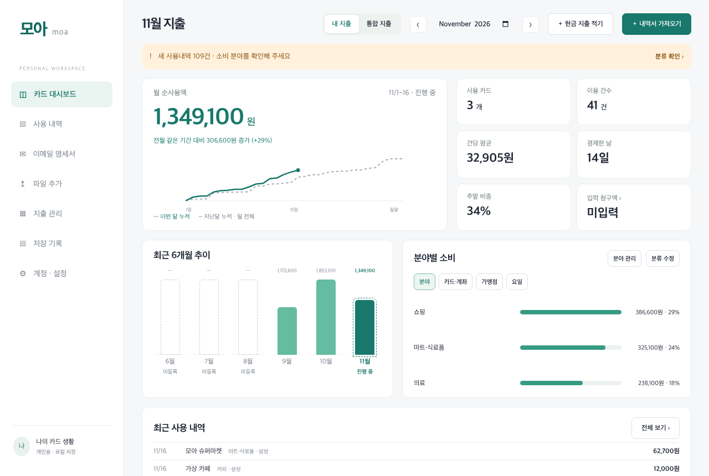
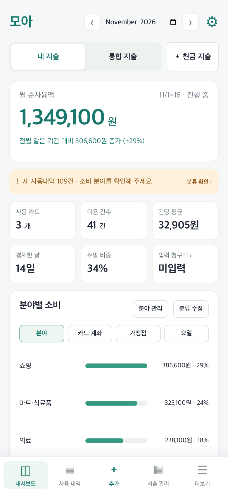
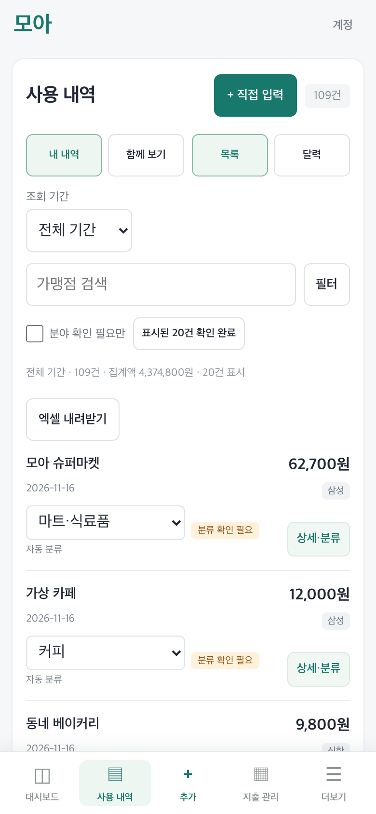

# 모아 — 가정용 카드·계좌 지출 관리

신한·삼성·현대·KB국민·우리·롯데 카드의 명세서를 가져와 이용일 기준 월별 순사용액과 카드별 내역을 확인하는 개인용 웹앱입니다. 선택적으로 CODEF 개인 연결을 등록해 하루 4회 자동 수집과 검증한 지출 저장을 사용할 수 있습니다.

개인 명세서·거래는 각자 관리합니다. 대시보드에는 통합 총액·분야·카드사 합계만 표시하고, 지출 관리의 ‘함께 열람’에서는 분류 규칙·할부·중복·고정 지출과 청구·납부·결제일을 구성원별로 읽을 수 있습니다. 상대방 자료는 수정할 수 없습니다. [개인 관리·통합 공유 안내](docs/PERSONAL_SHARING.md)에 업데이트 전 백업과 개인 Gmail 설정을 정리했습니다.

> **공개 범위와 주의사항**
>
> - 한 가구(소유자 1명 + 공동관리자 1명)가 **자기 서버(NAS·Mac)에 직접 설치해 쓰는** 개인 가계부입니다. 여러 사람에게 제공하는 서비스용으로 만들지 않았습니다.
> - 카드·계좌 자동 수집은 [CODEF](https://codef.io) API를 쓰며, 각자 CODEF 키를 발급받아 설정해야 합니다. 기본은 CODEF 데모 환경입니다.
> - 다른 사람의 금융 정보를 모아 주는 서비스로 운영하려면 관련 법(신용정보법 등)과 CODEF 정식 계약을 따로 확인해야 합니다.
> - 카드사 화면·응답이 바뀌면 판독·수집이 멈출 수 있습니다. 실제 명세서·카드번호·비밀번호를 이슈나 PR에 올리지 마세요.

## 이런 걸 할 수 있어요

- **명세서 가져오기**: 6개 카드사(신한·삼성·현대·KB국민·우리·롯데)의 CSV·엑셀·보안 HTML·PDF 명세서를 읽어 거래로 저장합니다.
- **자동 수집(선택)**: [CODEF](https://codef.io) 키가 있으면 휴대폰에서 카드·우리은행 계좌를 연결해 하루 4회 자동으로 가져옵니다. Gmail로 받은 명세서, 결제 문자도 받을 수 있습니다.
- **분석**: 이용일 기준 월별 순사용액, 분야·카드사·가맹점·요일 분석, 할부·중복·고정 지출(구독) 후보, 분야별 예산·연말정산 카드 공제.
- **두 사람이 함께**: 소유자와 공동관리자가 각자 거래를 관리하고, 합계와 (켜 둔 경우) 사용 내역을 함께 봅니다. 상대방 자료는 수정할 수 없습니다.
- **휴대폰 앱처럼**: 홈 화면에 추가해 쓰는 PWA입니다. 영수증 사진 붙이기, 현금 직접 입력, 엑셀 내려받기를 지원합니다.

<p>
  
  
  
</p>

화면의 가맹점·금액은 `manage.py demo`로 만든 가상 데이터입니다.

## 빠른 시작 — 가상 데이터로 둘러보기

실제 명세서 없이 3분이면 화면을 볼 수 있습니다. Python 3.12 이상이 필요합니다.

```sh
git clone https://github.com/Tira-studying/moa.git moa
cd moa
python3 -m venv .venv
.venv/bin/python -m pip install -r requirements.txt
CARD_DB=instance/demo.sqlite3 .venv/bin/python manage.py demo   # 가상 명세서 3개 저장
CARD_DB=instance/demo.sqlite3 .venv/bin/python app.py
```

브라우저에서 `http://127.0.0.1:5000`을 열고, `manage.py demo`가 알려 준 데모 비밀번호로 로그인합니다. 가맹점·금액은 모두 지어낸 값입니다. 데모 DB(`instance/demo.sqlite3`)는 지워도 됩니다. `manage.py demo`는 거래가 이미 있는 DB에는 아무것도 넣지 않습니다.

보안 HTML·PDF 명세서 읽기는 Node.js와 Chromium이 추가로 필요합니다(아래 [삼성·롯데카드 보안 HTML](#삼성롯데카드-보안-html-시험-기능)). CSV·엑셀은 위 설치만으로 됩니다.

## 실제로 쓰기

혼자 컴퓨터에서 쓰려면 위 명령에서 `manage.py demo` 대신 `manage.py`로 비밀번호를 정하고 `CARD_DB`를 빼면 됩니다(`instance/cards.sqlite3`에 저장). 이 개발 서버를 인터넷에 직접 노출하지 마세요.

휴대폰에서 쓰려면 집의 서버에 Docker로 설치하고 [Tailscale](https://tailscale.com)의 HTTPS 주소로 접속합니다. 공유기 포트를 열지 않습니다.

| 하고 싶은 일 | 안내 |
|---|---|
| NAS(x86-64)에 Docker로 설치 | [NAS 배포](deploy/NAS.md) |
| Apple Silicon Mac에 설치·이전 | [Mac 안내](deploy/MAC.md) |
| 공동관리자 추가와 접속 | [공동 관리](deploy/SHARING.md), [개인 관리·통합 공유](docs/PERSONAL_SHARING.md) |
| 홈 화면 앱으로 설치 | [PWA](docs/PWA.md) |
| 매일 DB 백업·복원 | [백업](deploy/BACKUP.md) |
| 서버 상태 알림·재부팅 복구 | [모니터링](deploy/MONITORING.md) |
| Gmail 명세서 자동 수집 | [Gmail](deploy/GMAIL.md) |
| 카드 자동 수집(CODEF) | [CODEF 키 설정](deploy/CODEF.md) → [자동 수집](deploy/CODEF_AUTO.md) → [휴대폰에서 연결](deploy/PHONE_CONNECTIONS.md) |
| 우리은행 입출금 | [우리은행](deploy/WOORI_BANK.md) |
| 결제 문자로 임시 소비 확인 | [문자 수신](deploy/SMS.md) |

CODEF는 기본이 데모 환경입니다. 정식 계약 뒤에는 `MOA_CODEF_ENV=production`으로 바꿉니다([CODEF 안내](deploy/CODEF.md#정식운영-환경으로-바꾸기)).

## 코드를 처음 읽는 분께

[파트별 코드 안내서](docs/CODE_GUIDE.md)에서 파일별 역할, 화면→API→DB 흐름, 로그인·공동 관리와 명세서 판독을 설명합니다. 주요 코드에도 한국어 설명과 구역 제목을 붙였습니다. 서식은 Python은 Black, 화면 코드는 Prettier를 씁니다(`pyproject.toml`, `.prettierrc.json`). 테스트는 `python -m unittest discover -s tests -q`로 실행하며, 화면까지 포함한 전체 검증 방법은 안내서의 검증 절에 있습니다.

# 자세한 기능 설명

## 화면 사용

아이폰에서는 하단의 6개 메뉴, PC에서는 왼쪽 메뉴로 화면을 전환합니다.

- **대시보드**: 월·내/통합 범위·가져오기를 한 줄에 모으고 월 순사용액·6개 지표, 누적 비교, 최근 6개월 세로 추이, 분야·카드·가맹점·요일 분석과 최근 거래를 표시합니다. 모바일 하단은 대시보드·사용 내역·추가·지출 관리·더보기의 5개이며 이메일 명세서·저장 기록은 더보기에서 엽니다.
- **사용 내역**: 기본값은 전체 기간입니다. 월별·직접 지정 기간, 카드사·가맹점 검색으로 저장된 모든 거래를 조회하고 ‘더 보기’로 추가 확인합니다.
- **이메일**: Gmail에서 수집한 명세서의 처리 상태와 일괄검토를 확인합니다. ‘목록 새로고침’을 누르면 5분 주기를 기다리지 않고 Gmail 수집을 요청하고 완료 후 목록을 갱신합니다.
- **파일 추가**: CSV·엑셀과 보안 HTML·PDF 중 필요한 양식을 선택합니다.
- **지출 관리**: 할부 납부 예상, 파일 간 중복 검토, 고정 지출 후보를 확인합니다.
- **저장 기록**: 저장된 파일의 내역을 확인하거나 삭제합니다.

월별 소비 추이는 취소·환불을 차감한 순사용액입니다. 카드 비중·가맹점 순위·건당 평균·요일 분석은 양수 이용금액만 집계하고, 내역이 없는 달은 미등록으로 표시합니다. 그래프의 월·카드·가맹점을 누르면 관련 사용 내역으로 이동합니다. 대시보드의 가상 예시는 실제 거래 조회에 섞이지 않습니다.

추출 결과와 날짜·금액 열 선택은 별도의 검토 화면에서 단계별로 진행합니다. 메뉴를 오가도 입력값은 유지되지만 페이지를 새로 열면 미저장 입력값은 사라집니다. 이메일 명세서와 저장 기록은 처음 10개씩, 사용 내역은 20개씩 표시하고 ‘더 보기’로 추가 확인합니다.


휴대폰의 **사용 내역**은 가맹점·금액·이용일·카드·분야를 한 화면 안의 목록으로 표시합니다. 조회 기간·월과 검색은 바로 사용하고, 카드·분야·집계 조건은 **필터**에서 펼칩니다. 접어도 적용 중인 조건 개수가 남으며 **필터 초기화**로 해제할 수 있습니다. 분류 안내는 필터 안에서 펼쳐 보고, 확인할 내역이 있을 때만 일괄 확인 버튼을 표시합니다. PC에서는 표와 필터를 계속 사용합니다.

## 소비 분야 분류

기존에 저장한 거래와 새로 저장하는 거래 모두 가맹점 이름으로 식비·커피·의료·마트·식료품·편의점·교통·차량·주유·쇼핑·문화·여가·교육·육아·구독료·통신·공과금·주거·생활·여행·숙박·보험·금융·기타·미분류 중 하나로 분류합니다. 가맹점 이름의 키워드에 따른 추정이며, 결제대행사 이름처럼 판단이 어려운 경우 미분류로 둡니다. 분류를 위해 외부 AI나 서비스에 거래를 전송하지 않습니다.

대시보드 **분야별 소비 패턴 → 분야 관리**에서 나만의 분야를 최대 30개 추가하고, 기본·추가 분야의 이름을 1~24자로 바꿀 수 있습니다. 설정은 계정별이며 다른 사람의 분야는 바뀌지 않습니다. 이름을 바꾸면 내 기존·새 거래와 분류 규칙의 표시도 함께 바뀌고 원본 거래·금액·메모는 유지합니다. 사용하지 않는 추가 분야만 삭제할 수 있으며, 기본 분야와 거래·가맹점 규칙에 사용 중인 분야는 보존합니다. 미분류 이름은 고정입니다. 육아·구독료도 기본 분야이며 어린이집·키즈카페, 넷플릭스 등 명확한 단서를 자동 분류하고 직접 지정한 분류가 우선합니다.

새로 등록한 사용 내역은 대시보드의 주황색 알림에 **소비 분야 확인 필요**로 표시됩니다. 알림을 누르면 확인할 거래만 모아 보고, 직접 분류를 수정하거나 **표시된 N건 확인 완료**를 누르면 알림이 해제됩니다. 이 버튼은 화면에 표시한 본인 내역만 처리하므로 이후 도착한 거래는 남습니다. 도입 이전의 기존 내역은 신규 알림 대상에서 제외하며, 이후 새 등록분부터 확인을 안내합니다. 대시보드를 보고 있을 때 30초마다 확인 필요 건수만 갱신합니다.

진행 중인 월의 순사용액은 한국시간 오늘까지, 전월 비교는 같은 날짜 구간을 사용합니다. 월말 날짜가 다르면 전월의 실제 월말까지 비교하며 지난달 누적 점선은 전체 기간을 표시합니다. 지난달 등록 내역이 없으면 비교를 보류합니다. 최근 6개월 차트는 진행 중·미등록·지출 0원을 구분하며, 카드 탭에서 취소·환불을 차감한 카드별 순사용액을 확인합니다. 집계 기준은 대시보드 하단 안내 한곳에서 확인할 수 있습니다.

대시보드의 기본 소비 그래프는 분야별 사용액과 비중입니다. 취소·환불은 비중 계산에서 제외하며, 월별 순사용액에는 기존처럼 반영합니다. 분야를 누르면 해당 월·분야의 실제 거래로 이동합니다.

일반 가맹점은 분야를 바꾸면 같은 이름의 과거·향후 거래에 공통 적용합니다. 공백·영문 대소문자는 구분하지 않고 지점명처럼 다른 이름은 별도로 처리합니다. ‘상세·분류’에서 ‘이번 거래만’을 선택하면 일반 가맹점도 개별 분류를 지정할 수 있습니다.

네이버페이·카카오페이·토스페이/토스페이먼츠·페이코·삼성페이/월렛·애플페이·구글페이·SSG페이·스마일페이·쿠페이·엘페이·KB페이·신한페이·하나페이·우리WON페이·페이북·제로페이·알리페이·위챗페이·페이팔·아마존페이 등 알려진 간편결제와 NHN KCP·KG이니시스·KG모빌리언스·나이스페이·다날·KSNET·페이레터·카페24 같은 결제대행 표기는 기본적으로 거래별로 분류합니다. 실제 가맹점을 입력한 경우에는 그 실제 가맹점에만 공통 분류를 지정할 수 있습니다. 간편결제 이름 자체에는 공통 분류를 지정하지 않습니다. 한글·영문 표기와 공백/구분자 변형을 인식합니다. 이전에 간편결제 이름에 저장한 공통 분류는 유지하되 적용하지 않으며, 실제 소비처가 드러나지 않으면 미분류로 둡니다.

‘상세·분류’에서 실제 가맹점과 메모를 거래별로 저장할 수 있습니다. 분류 우선순위는 거래별 직접 지정, 실제 가맹점의 공통/자동 분류, 원본 가맹점의 공통/자동 분류입니다. 실제 가맹점을 입력했다면 그 이름으로 판단하고, 메모는 검색에 사용합니다. ‘직접 지정 해제 · 기본 분류’로 선택한 범위의 직접 지정을 해제할 수 있습니다. 가맹점 공통 설정은 파일을 삭제 후 재등록해도 유지되고, 거래별 분류·실제 가맹점·메모는 해당 거래를 삭제하면 함께 삭제됩니다. 재시작 시에는 모두 유지됩니다.

가져오기에서 ‘실제·하위 가맹점’ 열을 선택하면 해당 정보를 원본 가맹점과 별도로 저장합니다. 명확한 실제/하위/세부 가맹점·판매자·판매처 열 이름이 있으면 선택 후보로 제안합니다. 원본 가맹점·금액·이용일과 중복 판정용 파일/표 해시는 변경하지 않습니다. 가맹점 순위에는 실제 가맹점을, 검색에는 원본/실제 가맹점과 메모를 반영합니다. 고정 지출은 실제 가맹점을 확인하지 못한 간편결제 이름만으로 판단하지 않습니다.

## 로컬 실행 참고

위 [빠른 시작](#빠른-시작--가상-데이터로-둘러보기)을 참고하세요. 기본 주소는 `127.0.0.1:5000`이며 `PORT`로 바꿀 수 있습니다. 원격 접속에는 HTTPS와 `MOA_PUBLIC_ORIGIN`이 필요합니다.

## 내역서 가져오기

1. 카드사에서 CSV 또는 암호 없는 XLSX로 내역을 내려받습니다. PDF/구형 XLS는 엑셀 등에서 변환이 필요합니다.
2. 카드번호·주민번호 등 불필요한 개인정보와 합계·안내 행을 제거합니다.
3. 카드사와 제목 행 번호(기본 1행)를 고르고 업로드합니다. XLSX는 첫 번째 시트만 읽습니다.
4. 미리보기에서 이용일·가맹점·이용금액 열을 지정하고 저장합니다.
5. 월·카드·가맹점으로 필터링합니다. 잘못 올린 파일은 가져온 파일 목록에서 삭제할 수 있습니다.

날짜는 연도를 포함해야 합니다(예: `2026-10-03`, `2026.10.03`, `20261003`). CSV는 UTF-8/CP949를 지원합니다. 금액은 원 단위 정수이며 쉼표·원 기호를 허용합니다. 취소·환불은 음수여야 합니다. 별도의 취소 상태 열을 자동 해석하지 않습니다. 오류가 하나라도 있으면 파일 전체를 저장하지 않고 오류 행을 안내합니다. 파일당 8MB, 20,000행, 100열 이하를 지원합니다.

동일 카드사에 **바이트가 같은 파일**을 다시 올리는 것은 차단합니다. 다른 파일에 겹치는 거래는 자동 제거하지 않으므로 같은 기간을 중복 업로드하지 마세요. 가맹점·날짜·금액이 같은 실제 복수 결제를 잘못 삭제하지 않기 위한 정책입니다.

합계는 **이용일 기준 순사용액**입니다. 명세서의 이용금액/청구금액 중 어떤 열을 선택하느냐에 따라 달라집니다. 할부 분할, 마감일, 수수료, 결제 예정액은 계산하지 않습니다. 실제 카드 청구서와 대조하세요. 실제 6개 카드사의 파일 양식은 아직 검증하지 않았으며 열을 직접 선택하는 범용 방식입니다.

## 할부·중복·고정 지출 관리

‘지출 관리’ 메뉴에서 세 기능을 각각 확인합니다.

- **할부 일정**: 원금·첫 납부 월·총 회차·완료 회차를 명세서와 대조해 직접 등록합니다. 회차별 원금을 균등 분할하고 나머지는 마지막 회차에 반영합니다. 향후 12개월 합계, 남은 원금·회차와 종료 월을 표시합니다. 수수료·이자는 포함하지 않으며, 할부 원금과 이번 달 청구액을 자동으로 추측하지 않습니다. 달이 지나도 납부 완료로 간주하지 않고 ‘납부 1회 반영’ 또는 수정에서 갱신합니다. 기준 월 이전의 미확인 원금은 별도로 표시합니다. 예상액을 실제 사용 내역에 추가하지 않습니다.
- **중복 검토**: 서로 다른 등록 파일의 카드사·이용일·공백/영문 대소문자를 정리한 가맹점 이름·부호를 포함한 금액이 같으면 후보로 표시합니다. 같은 파일 내부의 반복 거래나 다른 카드사·금액·날짜는 자동으로 합치지 않습니다. 파일 저장 시 새 내역의 중복 후보 건수를 안내합니다. 원본을 대조해 중복 건만 ‘집계에서 제외’하며 실제 거래는 삭제하지 않습니다. ‘제외한 내역’이나 중복 화면에서 복원할 수 있습니다. 다른 파일의 일치하는 집계 대상이 없는 마지막 내역은 제외하지 않습니다. 카드사만 저장하므로 같은 카드사의 서로 다른 카드로 한 정상 결제나 할부의 반복 청구가 후보에 포함될 수 있습니다. 명세서의 청구 월과 원문을 대조하세요.
- **고정 지출**: 같은 카드사·가맹점에서 기준 월 또는 직전 월까지 최소 3개월 연속으로 월 1회 결제되고, 관찰된 결제일 차이가 7일 이내인 후보를 찾습니다. 여러 번 결제했거나 취소·환불이 있는 달은 제외합니다. 최근 결제액·직전 대비 증감·최대 12개월 관찰 내역·다음 예상 날짜/금액을 표시합니다. 예상은 최근 결제 기준이고 다음 달에 같은 일자가 없으면 말일로 조정합니다. 할부나 우연한 반복 거래도 포함될 수 있으므로 ‘고정 지출로 확인’ 또는 ‘후보에서 제외’로 검토합니다. 확인/제외 설정은 같은 카드사·가맹점에 기억하며, 표시 대상은 계속 관찰 조건을 따릅니다.

집계에서 제외한 거래는 월별 합계·분야별 분석·고정 지출 후보 계산에서 빠집니다. 사용 내역의 표시 필터에서 집계 대상·제외한 내역·전체 기록을 선택할 수 있습니다. 모든 계산과 검토 설정은 NAS 안에서 처리합니다.

## 저장 및 개인정보

선택한 이용일·원본/실제 가맹점·메모·금액·카드사와 등록 파일명·해시·등록 시각, 직접 수정한 분야·할부 일정·집계 제외·고정 지출 확인 설정을 `instance/cards.sqlite3`에 저장합니다. 원본 파일은 디스크에 보관하지 않습니다. 최근 10개의 미리보기 데이터는 서버 메모리에 남으며 재시작 시 사라집니다. 저장 데이터는 암호화되지 않습니다. DB와 원본 명세서를 Git에 올리지 마세요. 이 환경의 파일시스템 스냅샷에 데이터가 포함될 수 있으므로 실제 금융 내역은 신뢰하는 개인 실행 환경에서 사용하세요.

가상 예시 보기와 샘플 CSV에는 가상 거래만 포함됩니다. 예시 보기 자체는 DB를 변경하지 않습니다.

## 검증

```sh
.venv/bin/python -m unittest discover -s tests -v
```

CSV(CP949 포함)·XLSX 가져오기, 금액/날짜 검증, 중복 차단, 원자적 저장, 삭제, 요청 보호를 검증합니다.

## 삼성·롯데카드 보안 HTML 시험 기능

추가 준비(Node.js 20+):

```sh
npm ci --ignore-scripts --cache /tmp/moa-npm-cache
# 시스템 Chromium이 있다면 자동 사용합니다. 다른 경로는 MOA_CHROMIUM으로 지정합니다.
# Chromium이 없다면 Playwright의 브라우저를 설치합니다:
node node_modules/playwright/cli.js install chromium
```

`카드 보안 HTML 열기`에서 파일과 비밀번호를 입력합니다. 비밀번호 필드는 요청 직후 지워집니다. 원본과 비밀번호는 파일·DB·로그에 기록하지 않으며, 브라우저 프로필은 임시 생성 후 종료 시 제거합니다. Python/JavaScript 메모리의 즉각적인 물리적 소거를 보장하지는 않습니다.

별도 Chromium 컨텍스트에서 문서를 열며 Chromium 자체 샌드박스를 유지합니다. 기본값에서는 일회성 문서를 제외한 브라우저 요청과 WebSocket, 팝업, 다운로드, 서비스 워커를 차단합니다. 삼성 공식 연결을 선택한 경우 HTTPS 삼성카드 도메인 요청과 최대 4개 창의 명세서 처리를 허용합니다. 앱의 쿠키·페이지·로그인 세션을 공유하지 않습니다. 샌드박스를 사용할 수 없는 환경에서는 오류를 표시하며 비활성화해서 실행하지 않습니다. 중첩 실행 샌드박스 때문에 시작이 실패한다면 Chromium의 샌드박스가 작동하는 실행 환경에서 서버를 시작해야 합니다.

추출한 거래 표를 고르고 제목 행·마지막 거래 행을 지정한 다음 기존 열 매핑에서 날짜·가맹점·금액을 선택합니다. 이때까지 DB에 저장되지 않으며 `내역 저장하기`를 눌러야 저장됩니다. 보안 파일의 전체 표와 선택한 미리보기는 각각 최대 10분 후 메모리에서 제거합니다. 서버 재시작 시에도 사라집니다. 등록 파일명은 저장되므로 개인정보가 없는 이름을 사용하세요.

이번 버전은 `#password`와 `#confirm`이 있는 입력 화면 및 날짜·가맹점·금액 헤더를 가진 HTML 표를 대상으로 합니다. 복잡한 양식과 할부 분할은 자동 보정하지 않습니다. 연도 없는 날짜는 사용자가 지정한 적용 연도로만 보완합니다. 실제 삼성카드 첨부파일은 비밀번호 화면 초기화까지만 확인했으며, 실제 비밀번호로 복호화와 거래 추출은 아직 검증하지 못했습니다. 실제 데이터를 보며 열과 합계를 확인해야 합니다. Gmail 자동 수집은 포함하지 않습니다.

원격 접속은 NAS 배포 안내의 개인용 Tailscale HTTPS 구성을 사용합니다. 로그인 없이 거래 API에 접근할 수 없습니다. 공개 인터넷 배포는 이 구성에 포함하지 않습니다.

브라우저 통합 검증(가상 파일만 사용):

```sh
MOA_BROWSER_TESTS=1 .venv/bin/python -m unittest discover -s tests -v
```

기본 테스트에서는 브라우저 통합 30개가 명시적으로 스킵됩니다. 위 명령은 브라우저 테스트까지 총 85개를 실행합니다.

보안 HTML 거래 표는 띄어쓰기·줄바꿈이 있는 제목, 최대 3행의 병합 제목, 중첩 표와 날짜/금액 형태의 수동 매핑 후보를 지원합니다. 해제 완료 응답 후 표를 찾지 못한 경우와 스크립트 오류를 구분합니다. 실패 시 표시하는 진단에는 프레임/표/오류/차단 요청 건수만 포함하며 개인 거래나 비밀번호는 포함하지 않습니다. 실제 삼성카드 파일의 복호화 성공을 보장하는 것은 아닙니다.

### 목록형 보안 명세서

표가 없는 프레임에서는 반복되는 거래 카드/목록의 이용일·가맹점·금액을 후보로 추출합니다. 결제 요약처럼 이용일이 없는 합계는 거래로 가져오지 않습니다. 이용금액과 청구금액이 함께 있으면 별도 열로 유지하고 사용자가 저장할 금액을 선택합니다. 명시적인 취소/환불 항목은 음수로 표시하고 부분취소 또는 여러 개의 모호한 금액은 빈 금액과 검토 안내를 표시해 무심코 저장되지 않도록 합니다. 같은 날짜/가맹점/금액의 실제 복수 거래를 합치지 않습니다.

`10.03` 또는 `26.10.03`처럼 연도가 없거나 두 자리인 날짜는 HTML 열기 화면의 적용 연도를 직접 입력해야 합니다. 두 자리 연도와 지정 연도가 다르면 저장을 거부합니다. 서로 다른 연도의 거래가 섞인 명세서에 일괄 연도를 지정하지 마세요. 전체 연도가 있는 날짜는 그대로 보존합니다. 후보는 자동 추정이므로 원문과 건수/합계를 반드시 대조해야 하며, 실제 삼성카드 복호화 후 목록 구조는 아직 검증하지 못했습니다.

### 롯데카드 보안 HTML

카드 보안 HTML 열기에서 롯데카드를 선택합니다. 롯데의 `UserFunc()` 확인 버튼을 사용하며 비밀번호는 기존과 같이 일회성으로 처리합니다. 실제 첨부파일의 비밀번호 화면과 버튼은 샌드박스에서 확인했으나 실제 비밀번호를 이용한 복호화는 아직 검증하지 않았습니다.

롯데 표의 한 셀에 함께 표시된 이용일/가맹점을 분리하고 소계·합계처럼 이용일이 없는 행은 거래로 가져오지 않습니다. 이용금액과 이번 달 원금 등 원래 열을 분리해 유지하므로 저장할 금액 열을 확인하세요. 취소 표의 원래 음수 금액을 유지하며, 양수 취소 금액을 섹션 제목만 보고 자동으로 바꾸지는 않습니다.

하나의 HTML에서 이용 내역과 취소 내역을 각각 선택해 저장할 수 있습니다. 같은 파일의 동일 표 재등록은 차단하고 다른 표는 허용합니다. 예전 버전에서 파일 전체 단위로 등록한 파일은 기존 등록을 확인한 후 삭제/재등록해야 새 방식으로 가져올 수 있습니다.

### 삼성카드 목록 인식 보완

`26.9.8`처럼 월/일이 한 자리인 날짜, 버튼 안에 들어 있는 거래, 여러 줄 가맹점명과 그 안의 숫자 식별자를 지원합니다. 숫자만 있는 가맹점 식별자를 금액으로 추정하지 않으며 원 단위 표시/금액 라벨/금액 영역을 확인합니다. 이자·수수료·이용금액·청구금액은 별도 열로 유지합니다.

해제된 문서에서 로컬 더보기 버튼과 접힌 일시불/할부 영역을 제한된 횟수로 펼칩니다. 기본값에서는 외부 링크를 누르지 않으며, 삼성 공식 연결을 선택하면 공식 HTTPS 페이지의 더보기 링크만 허용합니다. 보이는 소계의 거래 건수를 읽을 수 있으면 인식 건수와 비교하고, 다르거나 더보기가 진행되지 않으면 `incomplete` 오류로 부분 가져오기를 중단합니다. 소계 건수를 확인할 수 없는 양식은 완전성을 자동 보장하지 않으므로 원문 대조가 필요합니다. 실제 암호화 삼성 명세서의 해제 후 DOM은 여전히 미검증이며 사진 기반의 가상 양식으로 검증한 기능입니다.

### 화면 교체 방식 보안 명세서

암호 해제 후 `document.write`로 덮어쓴 문서는 최대 2MiB까지 작업 메모리에만 수집합니다. 실시간 화면에서 표를 찾지 못하면 외부 요청과 JavaScript 실행이 차단된 별도 브라우저 문서에서 이 내용을 읽습니다. 더보기나 접힌 거래 영역이 남거나 소계 건수가 다르면 부분 저장을 차단합니다. 실패 진단에는 읽기 버전, 해제 시작/완료 여부, 화면 쓰기 횟수와 문자 수, 암호 입력란 수, 보안 정책 차단 건수만 추가됩니다. 실제 암호 해제 성공은 미검증입니다.

암호 해제 결과가 외부 페이지를 여는 링크·폼·프레임·스크립트인 경우 `online_required`로 구분합니다. 이동 대상 주소와 토큰은 진단에 포함하지 않습니다. 기본값에서는 네트워크 접근을 허용하지 않습니다. 결과 문서의 구조 건수와 삼성 도메인 여부만 표시합니다. 사용자가 제공한 읽기 버전 3 진단에서는 삼성 도메인으로 향하는 폼과 이동 스크립트를 확인했습니다. 실제 열람 요청의 성공은 아직 검증하지 못했습니다.

### 삼성카드 공식 사이트 연결

암호 해제 결과가 공식 사이트로 폼을 전송하는 명세서는 화면의 `삼성카드 공식 사이트에 연결해 내역과 더보기 불러오기`를 선택합니다. 기본값은 꺼짐이며 롯데카드에는 적용하지 않습니다. 열람 정보가 삼성카드로 전송되고 쿠키는 일회성 브라우저 컨텍스트에서만 사용합니다. 앱 로그인 세션은 공유하지 않습니다.

연결은 `samsungcard.com` 및 하위 도메인의 HTTPS 443 포트만 허용합니다. DNS 결과가 내부·루프백·링크 로컬 주소이면 차단하고, 확인한 공인 주소로 TLS 연결을 고정합니다. 인증서 검증을 유지하며 리디렉션 대상마다 동일한 정책을 다시 적용합니다. 외부 WebSocket, 다운로드와 서비스 워커는 계속 차단합니다. 요청 200개·응답 8MiB·전체 응답 32MiB·전체 처리 약 55초로 제한합니다. 이미지·폰트·미디어 요청은 차단합니다.

폼 전송 뒤 거래 화면과 추가 창을 읽고, 더보기의 비동기 응답을 기다립니다. 소계 건수와 다르거나 더보기가 진행되지 않으면 부분 저장을 차단합니다. 공식 페이지 폼 전송과 늦은 더보기 응답은 가상 서버 응답으로 검증했으며 실제 삼성 서버·개인 명세서의 성공은 NAS에서 확인해야 합니다.

더보기 진행 여부는 화면 글자뿐 아니라 DOM, 높이, 버튼 표시 상태로 확인합니다. CSS로 펼쳐져 글자가 바뀌지 않는 화면을 지원하며 공식 요청 응답 중에는 다시 클릭하거나 저장하지 않습니다. 확장이 멈추면 소계/인식 건수, 서버 오류 응답 수, 마지막 HTTP 상태와 응답 대기 건수를 숫자로만 표시합니다.

### 신한카드 암호화 PDF

`카드 보안 명세서 열기`에서 `신한카드 (PDF)`를 고르고 PDF와 명세서 비밀번호를 입력합니다. 암호 없는 PDF는 비밀번호를 비워둘 수 있습니다. 신한 PDF에는 공식 사이트 연결 옵션을 적용하지 않으며 PDF의 스크립트·링크·첨부파일을 실행하지 않습니다. 별도 Python 작업에서 원본과 비밀번호를 메모리로 전달하고 최대 25초 동안 텍스트 표를 추출합니다. 원본 PDF·비밀번호는 파일이나 DB에 저장하지 않습니다.

최대 8MB·30쪽이며 선이 있는 표, 텍스트 정렬 표와 열 사이 공백을 순서대로 읽습니다. 추출 결과는 페이지/표별 후보이며 제목 행과 마지막 거래 행, 날짜·가맹점·금액 열을 직접 확인해야 합니다. 여러 표는 각각 저장합니다. 원문과 건수·합계·할부 금액을 대조하세요. 이미지 PDF의 OCR과 실제 신한 양식에 대한 자동 보정은 아직 지원하지 않습니다. 제공된 실제 PDF는 암호가 필요한 상태만 확인했으며 거래 내용의 추출 성공은 미검증입니다.

테스트 PDF는 가상 날짜·가맹점·금액으로 생성한 별도 파일입니다. 암호 해제, 잘못된 비밀번호, 미리보기 후 저장, 카드사 고정과 중복 차단을 검증합니다. 실제 명세서는 저장소와 테스트 이미지에 포함하지 않습니다.

삼성 목록 날짜의 `26. 9. 8` 공백, 여러 인라인 요소로 나뉜 날짜와 인접한 본인/가족·마스킹 카드 구분을 지원합니다. 날짜만 들어 있는 작은 요소를 합치며 가맹점의 숫자를 날짜로 취급하지 않습니다. 숨겨진 비밀번호 입력란 때문에 거래 폼 전체를 제외하지 않습니다. 두 자리 연도는 사용자가 지정한 연도와 대조하며 세기를 추측하지 않습니다. 실제 제공된 삼성 화면에서 38건이 모두 추출되는지는 재확인이 필요합니다.

CSV/XLSX 미리보기에서는 날짜 열이 인식되고 거래일이 비어 있거나 합계 표시인 경우, 파일 마지막의 명확한 `총 N건`·합계·소계 행을 제외하고 제외 건수를 표시합니다. 날짜가 있는 거래, 잘못된 날짜가 들어 있는 거래와 일반 안내 행은 자동으로 버리지 않으며 저장 시 검증합니다. 신한 엑셀의 거래 3건 뒤 `총 3건` 행이 붙는 구조를 가상 XLSX로 검증했습니다. 실제 엑셀 원본은 제공되지 않아 동일 파일로 재검증하지는 못했습니다.

삼성 거래가 작은 중첩 표로 구성되면 날짜 행과 별도로 있는 같은 행의 가맹점 셀·금액 셀을 연결합니다. 날짜/본인/승인 안내만 있는 행을 가맹점으로 고르지 않습니다. 더보기는 공백 텍스트, 이미지 alt, 입력 이미지, 접근성 이름과 `(25/38)` 같은 진행 건수를 지원합니다. 가상 중첩 표에서 처음 25건 뒤 이미지 더보기를 눌러 38건 전체를 읽는 흐름을 검증했습니다. 실제 명세서의 전체 추출 성공은 재확인이 필요합니다.

CSV/XLSX의 마지막 `총 N건` 행은 날짜가 없고 명확한 총건수 표시가 있으면 통화·소수점·추가 합계 셀이 있어도 제외합니다. 열 제목/합계의 보이지 않는 구분 공백도 정리합니다. 미리보기에는 데이터 행 번호와 `마지막 거래 행 (제목 제외)`를 표시해, 합계가 남으면 사용자가 마지막 거래까지만 지정할 수 있습니다. 선택 범위 안의 날짜·금액 오류는 계속 전체 저장을 차단합니다. 같은 파일은 선택 범위와 무관하게 중복 등록을 차단하므로 범위를 바꿔 재등록하려면 기존 등록을 먼저 삭제합니다.

### 삼성 화면 구조 진단 파일

실제 거래 페이지에서 `incomplete`가 발생하면 원본 DOM은 작업 중 NAS 프로세스 메모리에서만 전달하고, 별도 Python 변환기로 날짜·금액 숫자와 일반 텍스트를 가상값으로 바꿉니다. URL·ID·입력값·원본 클래스명·스크립트·이벤트 처리 코드와 임의 속성을 제거합니다. 공개된 UI 라벨/건수, 표 구조, 파서가 사용하는 의미 분류, 숨김 상태와 클릭/링크 종류만 남깁니다. 이미지 본문과 원본 파일명은 포함하지 않습니다. 큰 구조는 최대 12,000개 요소/약 500KB에서 자르고 `truncated`로 표시합니다.

실패 화면의 `진단용 가상 구조 파일 받기`로 JSON을 저장해 내용을 확인한 뒤 오류 분석에 전달할 수 있습니다. 앱은 가상 구조를 HTML로 실행하지 않으며 DB나 원본 파일로 저장하지 않습니다. 실제 날짜·가맹점·금액·주소·인증 정보는 분석을 위해 보내지 마세요. 진단 파일이 없거나 잘렸다면 UI에서 파일 제공 여부를 확인해야 합니다. 이 기능 자체는 삼성 인식 문제를 해결했다는 뜻이 아닙니다.

제공된 가상 구조로 날짜 후보 25개/거래 2건을 재현했습니다. 중첩된 날짜·카드 구분 요소를 단일 날짜로 합치고, 버튼의 독립된 `더보기` 텍스트를 읽어 접근성 페이지 안내와 구분합니다. 페이지 카운터가 마지막 페이지면 재클릭하지 않으며 소계 건수 확인은 유지합니다. 해당 가상 첫 화면의 12건 모두 가맹점과 금액이 채워지는 것을 확인했습니다.

삼성 목록의 주 표시 금액은 `화면표시금액`, 별도 금액은 `추가표시금액` 열에 보존하며 임의로 합산하지 않습니다. 할부의 화면 금액과 총 이용금액은 다를 수 있으므로 원문과 대조해 원하는 열을 선택하세요. 동일한 구조로 일시불 36건·할부 2건을 단계별 더보기로 읽는 가상 회귀 시험을 추가했습니다. 실제 삼성 서버에서 마지막 페이지까지의 성공은 NAS에서 확인해야 합니다.

### 현대카드 CP949 보안 HTML

`카드 보안 명세서 열기`에서 `현대카드 (HTML)`을 선택합니다. 파일과 명세서 비밀번호는 기존과 같이 일회성으로 처리합니다. 현대의 CP949 문자를 읽고 안내 입력칸에 포커스해 숨겨진 실제 비밀번호 입력란을 표시한 뒤, 같은 폼의 보안메일 확인 이미지 버튼을 누릅니다. 데스크톱/모바일 버튼이 함께 있어도 보이는 버튼 하나를 사용합니다. 암호 해제 함수를 직접 호출하거나 인증 성공 상태를 강제로 바꾸지 않습니다. 외부 통신과 삼성 전용 공식 연결은 허용하지 않습니다.

제공된 실제 HTML에서는 비밀번호 입력 없이 입력 화면 준비 상태만 확인했습니다. 거래 내용은 열지 못했으므로 실제 해제 후 표 양식 지원은 미검증입니다. CP949 가상 파일의 정상 비밀번호·오입력·숨김 입력란·이미지 제출·표 추출을 시험했습니다. 표를 고른 뒤 날짜·가맹점·금액을 원문과 대조하고 저장합니다. 표를 찾지 못하면 기존 가상 구조 진단 파일을 생성해 분석할 수 있습니다.

### KB 이용대금명세서 XLSX

일부 KB 파일은 `xl/styles.xml`의 세로 정렬에 잘못된 값(예: `left`)이 들어 있어 openpyxl이 읽기를 거절합니다. ZIP 압축 해제 크기를 먼저 확인한 뒤, 잘못된 세로 정렬 속성만 메모리에서 제거합니다. 셀 내용·숫자/날짜 서식·원본 파일은 변경하지 않습니다.

CSV/XLSX의 `제목 행 자동 찾기`는 처음 30행에서 날짜·가맹점·금액 제목을 찾고, 바로 아래의 원금/수수료 같은 보조 제목을 합칩니다. 자동 찾기를 끄면 기존처럼 행 번호를 직접 지정합니다. `두 자리·연도 없는 날짜에 적용할 연도`는 사용자가 명시적으로 지정하며 파일명이나 현재 연도로 추측하지 않습니다. 두 자리 연도와 다르면 저장을 거절합니다.

제공된 KB 파일에서는 제목이 2~3행이고 거래는 그 다음 5행입니다. `KB국민`·자동 제목 찾기·연도 `2026`·마지막 거래 행 `5`로 사용합니다. 마지막의 안내/집계 3행은 거래로 선택하지 않습니다. 실제 파일 읽기와 5건의 날짜·금액 검증은 메모리에서 확인했으며 원본이나 실제 거래를 저장소에 추가하지 않았습니다.

### Gmail 첨부 자동 수집과 공통 암호

NAS용 선택 서비스로 Gmail의 MOA 라벨을 읽어 명세서 첨부를 검토 대기 목록에 추가합니다. 공통 명세서 암호는 NAS 비밀 파일로 설정하며, 새 메일의 발신 인증 조건을 확인한 후 자동 열기를 시도합니다. 거래는 자동 저장하지 않습니다. 설정과 권한·동작 범위는 [Gmail 설치 안내](deploy/GMAIL.md)를 확인하세요. 기존 파일 업로드에는 Gmail 설정이 필요하지 않습니다. 실제 Gmail 연결은 미검증이며 가상 IMAP·MIME·API로 시험합니다.


### 우리카드 CP949 보안 HTML

‘파일 추가 → 보안 HTML·PDF’에서 ‘우리카드 (HTML)’을 선택합니다. CP949 원본을 메모리에서 읽고, 파일에 포함된 `decForm`의 비밀번호 입력란과 확인 버튼으로 정상 제출합니다. 암호 해제 후 `cipher` 프레임의 거래 표를 읽습니다. 해제 함수를 직접 호출하거나 외부 사이트 연결을 허용하지 않습니다. 비밀번호와 원본은 파일·DB에 저장하지 않습니다.

Gmail의 우리카드 HTML도 저장된 공통 비밀번호를 사용하는 검토와 일괄검토를 지원합니다. 자동 열기는 다른 카드사와 동일하게 공식 발신 도메인 및 Gmail의 DMARC 인증 조건을 확인합니다. 이미 수집한 파일이 오류 상태로 남아 있으면 카드사를 ‘우리’로 확인하고 ‘검토 시작’ 또는 일괄검토로 다시 확인하세요.

제공된 실제 첨부파일은 비밀번호를 입력하지 않고 암호 입력 화면의 인식까지만 확인했습니다. 실제 비밀번호로 해제한 거래 내역은 아직 검증하지 못했으므로 원문과 건수·금액을 대조해야 합니다. CP949 가상 명세서로 프레임 안의 표 추출, 이용금액·청구금액의 구분, 음수 금액 유지, 오입력 거부 및 우리카드로 저장되는 흐름을 검증했습니다. 실패 시 기존 가상 구조 진단을 사용할 수 있습니다.

우리카드 표에서 날짜 열에 들어간 `(M번호)카드…` 사용카드 구분 행, 소계·청구합계·청구계좌 안내 행과 반복된 열 제목은 미리보기 전에 제외합니다. 여러 카드 구분 사이의 실제 거래는 모두 유지합니다. 잘못된 날짜나 날짜가 빠진 미확인 거래 행은 임의로 버리지 않고 저장 검증에서 오류를 표시합니다. `09/10`처럼 연도가 없는 이용일에는 실제 이용 연도를 지정해야 합니다. 제외 전 원본 표의 해시를 중복 판정에 사용하므로 이전 버전에서 같은 표를 저장했어도 다시 중복 집계하지 않습니다.

### 월별 카드값 · 명세서 확인

대시보드의 ‘이번 달 카드값 · 명세서 확인 → 확인 · 입력’ 또는 ‘지출 관리 → 카드값 · 명세서’에서 확인합니다. 조회 월은 이용한 월이 아니라 **납부할 월**입니다. 신한·삼성·현대·KB국민·우리·롯데를 기본 대상으로 하며, 각자 필요한 카드사를 추가하고 표시 이름과 사용 여부를 설정할 수 있습니다. 카드사별 합산 청구액을 기록합니다.

- 월마다 명세서 미확인 / 명세서 확인 / 이번 달 청구 없음, 최종 청구액, 납부 예정일, 실제 납부 완료를 직접 저장합니다. ‘미확인’은 미수신 또는 미검토 상태이며 이메일 수신이나 거래 저장과 자동 연동하지 않습니다. 이용일이나 파일명으로 청구 월을 추정하지 않습니다.
- 대시보드는 현재 월의 입력 청구액 합계, 납부 전 금액, 명세서 미확인 수와 청구액 미입력 수를 보여줍니다. 미입력은 0원 확정과 구별하며 합계는 입력 금액만 반영합니다. 납부 완료는 명세서 확인과 청구액 입력 후에만 가능하며 취소할 수 있습니다. 거래·소비 집계에는 추가하지 않습니다.
- ‘내 카드사 추가 · 표시 이름 · 기본 결제일 설정’에서 개인 카드사 추가, 표시 이름, 사용 여부와 1~31일 기본 결제일을 저장합니다. 짧은 달은 말일로 보정하고 휴일은 계산하지 않습니다. 실제 출금일이 다르면 월별 예정일을 지정하며 비우면 기본값을 사용합니다. 사용 해제하면 모든 월의 확인 대상과 합계에서 빠지며 기존 기록은 보관합니다.
- 월이 바뀌면 새로운 확인 상태로 시작하고 과거 입력값·납부 여부는 유지합니다. SQLite의 `billing_settings`, `monthly_bills`에 기록하며 기존 DB는 앱 시작 후 연결 시 테이블을 추가합니다. 명세서 삭제가 수동 확인 기록을 지우지는 않으므로 수정한 청구서는 이 화면에서도 다시 대조하세요.

명세서의 최종 청구액·청구 월 자동 추출과 실제 은행 출금 확인은 이번 기능에 포함되지 않습니다. 실제 카드값은 카드사 명세서와 대조해 입력하세요.

### 개인 관리와 통합 지출

소유자(`owner`)와 활성 공동관리자 1명이 각자의 명세서·거래·메일·분류·납부 기록을 관리합니다. 대시보드의 ‘내 지출 / 통합 지출’에서 전환하며, 통합 화면에는 활성 구성원의 총액·분야별·카드사별 합계와 월별 추이만 표시합니다. 상대방의 원본·메모·일반 거래 목록은 비공개입니다. 지출 관리의 ‘함께 열람’에서 허용된 관리 항목과 그에 필요한 가맹점·날짜·금액만 읽을 수 있고 변경은 본인만 가능합니다.

기존 자료는 소유자 계정에 보존하고 새 구조 적용 시 기존 세션은 종료합니다. **업데이트 전 DB를 백업하고 두 사람 모두 다시 로그인하세요.** 개인 자료의 동시 수정 버전과 변경 이력도 사용자별로 분리합니다. 자세한 권한·이전·개인 Gmail 설정은 [개인 관리와 통합 공유 안내](docs/PERSONAL_SHARING.md)를 확인하세요.

Tailscale의 moa-card 장치 공유와 별도 로그인 방식은 유지합니다. 접속 설정은 [공동 관리 설치 안내](deploy/SHARING.md), Mac 이전은 [Mac 이전 안내](deploy/MAC.md)를 참고하세요.

## 결제 문자로 임시 소비 확인

문자 소비 요약과 메뉴는 기본 화면에서 숨겨 두었습니다. 로그인한 모아 주소 뒤에 `/#sms`를 붙이면 기존 **실시간 소비 · 문자** 화면을 열 수 있습니다. KB국민·신한·삼성·현대카드 국내 원화 승인·취소 문자를 아이폰 단축어로 받을 수 있습니다. 계정별 쓰기 전용 키를 사용하고 원문·이름·누적액은 저장하지 않습니다. 명세서 원장과 합산하지 않으며 대조 후 완료 처리합니다. 서버 업데이트와 단축어 설정은 [아이폰 문자 연결 안내](deploy/SMS.md)를 참고하세요. 그 외 카드사·해외 결제 양식과 실제 기기의 자동 실행은 별도 검증이 필요합니다.


지출 관리의 카드사 설정은 계정별입니다. 추가 카드사는 30개까지 등록하며 청구액·결제일·할부 수동 관리에 사용할 수 있습니다. 다른 계정이 같은 카드사를 등록해도 설정과 기록이 섞이지 않습니다. 표시 이름은 원래 카드사 옆에 보이고 식별자·과거 거래를 바꾸지 않습니다. 이름을 비우고 저장하면 원래 이름으로 돌아옵니다. 함께 열람에서는 각자의 청구 카드 표시 이름을 확인할 수 있으나 상대방 자료는 수정할 수 없습니다. 직접 추가한 카드사는 명세서·문자 판독 지원이 자동으로 생기는 기능이 아닙니다.

**실시간 소비 · 문자**에서는 대조 완료한 문자도 기본 목록과 월별 문자 기준 소비 합계에 계속 표시합니다. 제외한 건만 빠지며 제외 내역 보기에서 복원할 수 있습니다. 대시보드 문자 요약은 숨겨 두고 관련 자동 조회도 멈춥니다. 기존 수신 키·문자 내역·단축어 수신은 유지하며 명세서 합계와 자동으로 더하지 않습니다.

자동 조회는 한국시간 매일 00:00·08:00·14:00·20:00의 하루 4회로 계획합니다. [데모 키 설정·개발자 인증·삼성·현대·KB국민·신한·롯데·우리카드 수동 실조회 시험](deploy/CODEF.md)을 제공하며, [개인 연결·자동 수집·지출 저장](deploy/CODEF_AUTO.md)을 제공합니다. 일회성 시험과 별도로 카드사를 연결하고 수집 작업자를 켜야 하며, 추가 인증이 필요한 카드는 보류됩니다.


**공동관리자도 본인 휴대폰에서 [카드·계좌 연결](deploy/PHONE_CONNECTIONS.md)**을 진행할 수 있습니다. 모아에 로그인한 뒤 **더보기 → 카드·계좌 연결**에서 본인의 금융기관 홈페이지 아이디로 인증합니다. 문자·이메일·앱 인증과 KB 일회성 소지 확인도 같은 화면에서 이어가며 로그인 비밀번호·인증번호는 보관하지 않습니다. 실패·취소 시 기존 연결과 내역을 유지합니다.

현대 웹 연결은 동일한 RSA PIN 암호문의 재사용을 검증한 뒤 카드번호와 PIN 암호문을 별도 비밀 키로 다시 암호화해 DB에 보관합니다. 기존 [운영자용 비밀 파일 방식](deploy/CODEF_AUTO.md#현대-암호화-추가-인증으로-자동-수집하기)도 유지합니다. PIN 평문은 보관하지 않으며 저장할 암호문을 읽은 조회까지 확인해야 자동 수집 대상으로 바뀝니다.

[우리은행 개인 입출금 연결](deploy/WOORI_BANK.md)은 **더보기 → 카드·계좌 연결 → 계좌 → 우리은행**에서 본인이 인증한 뒤 **계좌 입출금**에서 확인합니다. 최근 30일을 기존 CODEF 작업자가 하루 4회 수집하며 인증정보 암호화 저장에는 도구에서 별도로 동의합니다. **소비로 선택**에 체크한 출금만 합산하고, 해제하면 반영을 취소합니다. 선택하지 않은 내역은 정리 알림에 넣지 않습니다. 소비 분야는 사용 내역이나 **분류·상세**에서 나중에 정할 수 있고, 재선택해도 기존 분류·메모는 보존합니다. 카드 후보가 있으면 별개 지출임을 추가 확인하며, 나중에 새 후보가 들어오면 선택한 계좌 소비만 보류하고 알립니다. 입금·0원 기록은 소비로 반영하지 않습니다. 다른 은행·지역화폐는 포함하지 않습니다.

## 라이선스

[MIT](LICENSE). Playwright 관련 고지는 [deploy/LICENSE.playwright.txt](deploy/LICENSE.playwright.txt)를 참고하세요.
