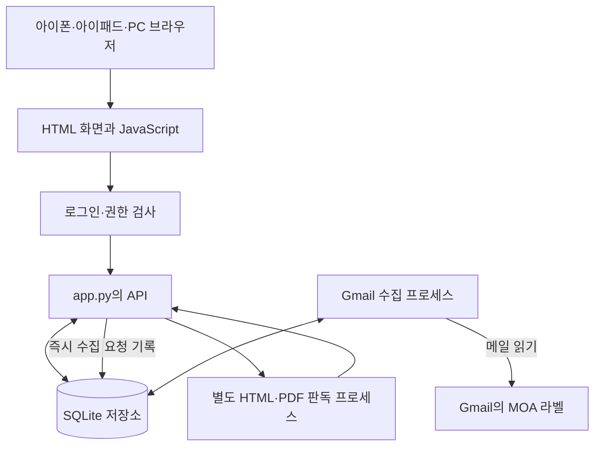

# 모아 코드 읽기 안내서

모아는 카드 명세서를 읽어 거래로 저장하고, 각자 개인 원장을 관리하고 통합 지출 합계와 허용된 관리 정보를 함께 보는 웹앱입니다. 이 안내서는 현재 코드가 하는 일을 파일·기능별로 설명합니다. NAS 설치는 [NAS 안내](../deploy/NAS.md), Gmail 연결은 [Gmail 안내](../deploy/GMAIL.md), 계정과 Tailscale 공유는 [공동 관리 안내](../deploy/SHARING.md)를 참고하세요. Mac으로 서버를 옮기는 구성은 [Mac 이전 안내](../deploy/MAC.md)에 있습니다.

## 1. 처음에는 이 순서로 읽으세요

| 순서 | 파일 | 먼저 확인할 내용 |
| --- | --- | --- |
| 1 | [templates/index.html](../templates/index.html) | 어떤 화면과 입력칸이 있는지 |
| 2 | [static/app.js](../static/app.js) | 공통 도구·탭 이동·서버 통신(`api`). 화면별 동작은 `transactions.js`·`imports.js`·`mail.js` |
| 3 | [app.py](../app.py) | 요청을 검사하고 데이터를 읽거나 저장하는 과정 |
| 4 | [categories.py](../categories.py), [finance.py](../finance.py) | 소비 분야·할부·중복·고정 지출을 계산하는 규칙 |
| 5 | [auth.py](../auth.py), [collaboration_access.py](../collaboration_access.py) | 로그인·권한·동시 수정 방지 |
| 6 | [gmail_inbox.py](../gmail_inbox.py), [mail_worker.py](../mail_worker.py) | 이메일 목록이 자동으로 채워지는 과정 |
| 7 | [secure_html.py](../secure_html.py), [scripts/](../scripts/) | 암호 명세서를 별도로 열고 표를 찾는 과정 |
| 8 | [tests/](../tests/) | 정상 입력·오류 입력·화면 동작의 기대 결과 |

모든 파일을 한 번에 이해할 필요는 없습니다. 예를 들어 납부 기록이 궁금하면 `billing.js → app.py의 billing_update → finance.py의 validate_bill` 순서로 따라가면 됩니다.

## 2. 전체 연결 구조



- **브라우저**는 사용자가 보는 화면입니다. HTML은 화면 구성, CSS는 모양, JavaScript는 클릭·입력·서버 통신을 담당합니다.
- **서버**는 NAS에서 실행되는 Python 프로그램입니다. 브라우저 요청을 검사하고 실제 저장과 계산을 담당합니다.
- **API**는 화면과 서버가 주고받는 약속입니다. 예를 들어 `/api/data`는 거래 자료를 읽는 주소입니다.
- **SQLite**는 데이터를 파일 하나에 저장하는 DB입니다. 운영 환경에서는 Docker의 `card-data` 볼륨 안에 둡니다.
- **수집 프로세스**는 웹 화면을 열어 두지 않아도 이메일을 확인하는 별도 프로그램입니다.

Tailscale은 브라우저가 NAS의 모아에 접속할 수 있게 하는 네트워크 계층입니다. 모아의 로그인 계정과 Tailscale 계정은 서로 별개입니다.

## 3. 화면 코드 읽기

### HTML과 JavaScript는 id로 연결됩니다

가령 HTML에 `id="billing-summary"`인 영역이 있으면, JavaScript의 `$('billing-summary')`가 그 영역을 찾습니다. `$`는 `document.getElementById()`에 붙인 짧은 이름입니다. 외부 라이브러리의 특별한 문법은 아닙니다.

```javascript
// 글자를 화면에 표시합니다. 서버의 거래를 수정하는 코드가 아닙니다.
$('billing-summary').textContent = '입력한 청구액을 확인하세요.';
```

HTML의 `data-view="planning"` 같은 `data-` 속성은 화면 이동에 필요한 표식입니다. 이름만 바꾸면 연결된 JavaScript가 영역을 찾지 못할 수 있습니다.

### 화면 파일별 역할

| 파일 | 담당 화면·역할 |
| --- | --- |
| `static/app.js` | 공통 도구(`$`, `won`, `escapeHTML`), 메모리 상태, 탭 이동, 공통 통신(`api`), 대시보드 그리기 |
| `static/transactions.js` | 사용 내역 검색·필터, 거래별 분류·실제 가맹점·메모 수정 |
| `static/calendar.js` | 사용 내역의 목록·달력 전환, 날짜별 순사용액 달력(계산은 `analytics.js`의 `calendarMonth`) |
| `static/manual-entry.js`, `manual_entries.py` | 현금·계좌이체·지역화폐·온누리상품권 등 직접 입력 지출의 추가·수정·삭제(첫 화면·사용 내역·파일 추가의 `[data-manual-open]` 버튼, 결제 수단·월별 저장 기록 `manual:YYYY-MM`, `payment_kind='manual'`) |
| `static/export.js`, `export_xlsx.py` | 사용 내역 엑셀 내려받기·휴대폰 공유(`/api/export.xlsx`, 화면 조건 그대로, 수식 주입 방지) |
| `static/imports.js` | 저장 기록, CSV·엑셀 미리보기와 열 지정, 보안 HTML·PDF 표 선택, 로그아웃. 끝에서 첫 `refresh()` 호출 |
| `static/mail.js` | 이메일 명세서 목록·즉시 새로고침·일괄 검토·1분 자동 갱신 |
| `static/planning-tools.js`, `features.py`, `budgets.py`, `tax_deduction.py`, `subscriptions.py` | 화면 기능 켜기·끄기, 분야별 예산·초과 알림, 연말정산 카드 공제 추정, 구독·정기 결제 요약(모두 기본 꺼짐) |
| `static/card-performance.js`, `card_performance.py` | 카드 상품별 전월 실적(지출 관리 ‘카드 실적’ 탭·대시보드 요약), 카드 추가·수정, 명세서-카드 연결 |
| `static/analytics.js` | 브라우저에서 소비 분석 자료를 계산 |
| `static/finance.js` | 할부·중복 검토·고정 지출 화면 |
| `static/billing.js` | 월별 청구액·납부 여부·기본 결제일 화면 |
| `static/dashboard.js` | 같은 기간 비교·누적/세로 추이·최근 거래·신규 분야 확인 알림 |
| `static/categories.js` | 개인 분야 추가·이름 변경·미사용 추가 분야 삭제 |
| `static/connection-setup.js`, `connection_setup.py` | 본인 휴대폰의 카드·계좌 연결, 세션에 결합된 추가 인증 |
| `static/sms.js`, `sms_inbox.py` | 개인 문자 임시내역·단축어 쓰기 전용 수신 키·명세서 대조 후보 |
| `static/sharing.js` | 공동관리자 계정·본인 비밀번호·변경 이력 화면 |
| `static/login.js` | 로그인 폼 제출과 로그인 결과 처리 |
| `static/household.js` | 서버가 집계한 통합 지출만 표시 |
| `static/shared-management.js`, `shared_management.py` | 허용된 관리 필드만 구성원별 읽기 공유 |
| `static/shared-activity.js`, `shared_spending.py` | 사용 내역 ‘함께 보기’: `share_transactions`(기본 켜짐)인 구성원의 한 달 내역·메모를 읽기 전용으로(`/api/shared-transactions`, `shared_hidden` 거래·제외 거래는 뺌) |
| `static/receipts.js`, `receipts.py` | 거래 영수증 사진: 거래 상세·직접 입력 창에서 사진을 붙이고·크게 보고·지웁니다. 화면이 긴 변 1600px JPEG로 줄여(EXIF 제거) 올리고, 서버는 JPEG·PNG·WebP 서명만 받아 DB(`transaction_receipts`)에 저장합니다. 주인만 올리고 지우며, 상대는 함께 보기에 보이는 거래의 사진만 `/api/shared-receipts/<id>`로 봅니다 |
| `static/pwa.js`, `static/sw.js` | 홈 화면 설치·복귀 시 세션 확인·연결 실패 안내 |
| `static/style.css` | 색상·배치·버튼·모바일 화면 규칙 |

`index.html`의 `script`에는 `defer`가 붙어 있습니다. HTML을 읽은 뒤 정해진 순서로 실행한다는 뜻입니다. 순서는 `app.js → transactions.js → imports.js → mail.js → 나머지`입니다. 네 파일은 원래 한 파일이던 것을 구역별로 나눈 것이라 전역 이름(`state`, `secureResult` 등)을 함께 씁니다. `app.js`의 공통 도구를 나중 파일들이 사용하고 `billing.js`는 `finance.js`의 `stat()`도 사용하므로, 파일을 모듈 방식으로 바꾸거나 순서를 바꾸려면 호출 관계를 먼저 확인해야 합니다.

### 자주 나오는 JavaScript 표현

| 표현 | 이 코드에서의 의미 |
| --- | --- |
| `state` | 화면이 최근 서버에서 받은 거래·저장 기록 |
| `filter()` | 조건에 맞는 거래만 고르기 |
| `map()` | 각 거래를 화면 표시나 다른 자료 형태로 바꾸기 |
| `reduce()` | 거래 금액을 합계 하나로 모으기 |
| `async` / `await` | 서버 응답을 기다린 뒤 이어서 처리하기 |
| `try` / `catch` / `finally` | 정상 처리·실패 안내·버튼 복구를 구분하기 |
| `?.` / `??` | 값이 없을 수 있는 경우 안전하게 읽거나 기본값 사용하기 |
| `escapeHTML()` | 외부 문자열을 HTML 코드로 실행되지 않는 표시용 글자로 바꾸기 |

`state`는 브라우저 메모리의 복사본입니다. 화면에서 입력값만 바꿨다고 DB가 바뀌지는 않습니다. 저장 API가 성공해야 실제 기록이 바뀝니다.

## 4. Python 서버와 API 읽기

`app.py`는 다음 구역으로 나뉩니다.

1. 앱 설정과 메모리 업로드 방식
2. DB 연결과 공통 오류 응답 (테이블 구조는 `migrations.py`)
3. 날짜·금액·CSV·XLSX 해석
4. 이메일 목록·수집·검토 API
5. 표 정리와 미리보기
6. 암호 명세서 판독
7. 거래 저장·조회·분류
8. 할부·중복·고정 지출
9. 월별 청구·납부 기록

```python
@app.get('/api/data')
def get_data():
    # 실제 구현에서는 DB를 읽고 분류 규칙을 적용해 JSON으로 돌려줍니다.
    ...
```

`@app.get()`은 아래 함수를 특정 URL의 읽기 요청과 연결하는 **데코레이터**입니다. `POST`는 새 처리 시작이나 추가, `PUT`은 수정, `DELETE`는 삭제에 사용합니다. 함수에 도달하기 전에도 로그인과 공동 수정 검사가 실행될 수 있습니다.

주요 URL은 다음과 같습니다.

| 기능 | 요청 |
| --- | --- |
| 문자 임시내역 / 단축어 수신 | `GET /api/sms?month=YYYY-MM`, `POST /api/sms/receive` |
| 문자 키 발급·해제 / 대조 상태 | `POST·DELETE /api/sms/key`, `PUT /api/sms/events/<id>` |
| 현재 로그인 상태 | `GET /api/session` |
| 로그인 / 로그아웃 | `POST /api/login`, `POST /api/logout` |
| 거래·저장 기록 조회 | `GET /api/data` |
| CSV·엑셀 미리보기 | `POST /api/preview` |
| 보안 명세서 열기 / 표 선택 | `POST /api/secure-html`, `POST /api/secure-preview` |
| 거래 저장 / 등록 삭제 | `POST /api/import`, `DELETE /api/imports/<id>` |
| 거래 분류·메모 수정 | `PUT /api/transactions/<id>/category` |
| 새 거래의 분야 확인 건수 / 표시한 거래 확인 완료 | `GET·PUT /api/category-reviews` |
| 내 분야 목록 / 추가 | `GET·POST /api/categories` |
| 내 분야 이름 변경 / 미사용 추가 분야 삭제 | `PUT·DELETE /api/categories/<key>` |
| 이메일 목록 / 즉시 수집 요청 | `GET /api/mail`, `POST /api/mail/refresh` |
| 지출 분석 | `GET /api/finance?month=YYYY-MM` |
| 개인 카드사 추가 | `POST /api/billing/cards` |
| 월별 청구 조회 / 저장 | `GET /api/billing?month=YYYY-MM`, `PUT /api/billing/<month>/<card>` |
| 공동 계정 조회 / 추가 | `GET /api/members`, `POST /api/members` |
| 변경 이력 | `GET /api/audit` |

주소의 `<id>` 등은 실제 거래 번호나 카드사 값으로 채워지는 부분입니다. 직접 DB를 수정할 필요 없이 화면에서 이 요청을 보냅니다.

## 5. 어떤 자료를 어디에 저장하나요?

| 종류 | 저장 위치 | 설명 |
| --- | --- | --- |
| 등록 파일의 메타데이터 | `imports` | 카드사·파일명·중복 판정 해시·등록 시각 |
| 실제 거래 | `transactions` | 이용일·원래 가맹점·선택한 금액 |
| 가맹점 공통 분류 | `merchant_categories` | 같은 이름에 적용할 직접 분류 |
| 거래별 보충 정보 | `transaction_annotations` | 거래별 분야·실제 가맹점·메모 |
| 개인 분야 설정 | `spending_categories` | 계정별 표시 이름·추가 분야, 기존 분류 키 유지 |
| 신규 거래 분야 확인 | `category_reviews` | 확인한 거래 ID·확인 시각, 거래 삭제 시 함께 정리 |
| 소비 집계에서 제외한 거래 | `transaction_exclusions` | 원본 삭제 없이 제외 여부 기록 |
| 직접 등록한 할부 | `installment_plans` | 원금·회차·첫 납부 월·완료 회차 |
| 고정 지출 확인 | `recurring_decisions` | 반복 결제 후보의 확인·제외 결정 |
| 카드사 기본 설정 | `billing_settings`, `billing_card_labels` | 개인 기본·추가 카드사 사용 여부·기본 결제일·표시 이름 |
| 월별 청구·납부 기록 | `monthly_bills` | 청구액·명세서 확인·납부 상태 |
| 문자 수신 설정·개인 임시내역 | `sms_keys`, `sms_events` | 키 해시와 추출 필드만 저장, 실제 원장과 합산하지 않음 |
| 로그인 계정과 세션 | `users`, `sessions` 등 | 비밀번호 해시와 세션 토큰 해시 |
| 공동 수정과 변경 이력 | `workspace_revision`, `audit_log` | 공유 버전과 작업자·종류·대상·시각 |
| 이메일 수집 상태 | `mail_candidates`, `mail_cursors`, `mail_status`, `mail_control` | 첨부 후보·마지막 수집 위치·진행 상태·즉시 요청 |
| 저장 전 표 | 서버 메모리의 `previews`, `secure_tables` (`preview_store.py`) | 사용자별 임시 결과, 10분 후 자동 삭제, 사용자별·전체 개수 제한 |
| Gmail 앱 암호·공통 명세서 암호 | NAS의 별도 비밀 파일 | DB·화면에 암호 원문을 넣지 않음 |
| 이메일 원본 첨부 | Gmail | 선택하면 필요한 원본을 다시 읽음 |

### DB 구조 버전 관리 (`migrations.py`)

DB 파일 안의 `PRAGMA user_version` 숫자가 적용한 단계 번호입니다. `connect()`는 연결마다 이 숫자만 확인하고, 최신보다 낮을 때만 남은 단계를 실행합니다.

| 버전 | 단계 | 내용 |
| --- | --- | --- |
| 1 | `baseline` | 버전 관리 도입 전의 모든 `schema()` 실행. 어떤 예전 DB든 여기서 최신 형태가 됩니다 |
| 2 | `transaction_import_index` | `transactions(import_id)` 색인 |
| 3 | `card_products` | 카드 상품 표, 거래·CODEF 기록의 카드 끝 4자리, 명세서-카드 연결, 사용자별 기능 켜기·끄기(`user_features`) |
| 4 | `planning_tools` | 연말정산 카드 공제 설정(`tax_settings`), 분야별 월 예산(`budgets`) |
| 5 | `manual_entries` | 직접 입력 지출의 결제 수단·현금영수증 여부(`manual_entries`) |
| 6 | `spending_choices` | `transaction_exclusions.reason`(`duplicate`/`not_spending`: 거래 상세의 ‘소비에서 제외’), 함께 보기에서 숨길 거래 `shared_hidden` |
| 7 | `payment_times` | `transactions.used_time`(CODEF 승인 시각 HH:MM, 재조회 때 빈 값만 채움). 함께 보기의 날짜·시각순 정렬에 사용 |
| 8 | `receipt_photos` | `transaction_receipts`(거래별 영수증 사진, 거래 삭제 시 함께 삭제). 사진이 DB에 있어 매일 백업에 함께 들어감 |
| 9 | `remember_login` | `sessions.remember`(로그인 유지 세션 표시: 90일, 하루 한 번 이상 쓰면 다시 90일로 연장) |

테이블·컬럼을 바꿀 때는 각 파일의 `schema()`를 고치지 말고 `migrations.py`의 `MIGRATIONS` **맨 끝에** 새 단계를 추가합니다. `schema()`는 1단계 안에서만 실행되므로 이미 운영 중인 DB에는 반영되지 않습니다. 컬럼 추가는 `add_column()`으로 여러 번 실행해도 안전하게 씁니다. 예전 DB를 흉내 내는 테스트는 `PRAGMA user_version = 0`으로 되돌린 뒤 다시 연결합니다. 검증은 `test_migrations.py`에 있습니다.

### 카드 전월 실적 (`card_performance.py`)

거래를 카드 상품에 연결하는 순서는 ① 거래의 카드 끝 4자리(CODEF 수집 때 저장) ② 명세서를 통째로 연결한 카드 ③ 그 카드사에 카드가 한 장뿐이면 그 카드입니다. 셋 다 아니면 "카드를 알 수 없는 거래"로 따로 보여 주고 추측하지 않습니다. 카드 번호는 끝 4자리만 저장합니다. 이미 저장한 CODEF 거래는 다시 조회될 때 끝자리만 채웁니다. 분야 단위 제외만 지원하므로 할인받은 금액·무이자할부 등 카드사의 세부 제외 규칙과는 다를 수 있습니다. 추천 값(`PRESETS`)은 처음 입력용이며 사용자가 고칠 수 있습니다. 검증은 `test_card_performance.py`와 `card-performance-ui.cjs`에 있습니다.

### 예산·연말정산·정기 결제 (기본 꺼짐)

설정의 ‘화면 기능 켜기 · 끄기’에서 사용자마다 켭니다(`features.py`). 꺼진 기능의 API는 계산 없이 `{"enabled": false}`만 돌려줍니다.

- `budgets.py`: 이번 달 분야별 순사용액을 예산과 비교해 over(초과)·warn(80% 이상)·pace(지난 날짜 비율보다 10%p 이상 빠름)·ok로 나눕니다. over·warn은 대시보드 ‘확인할 일’에 알림을 띄웁니다.
- `tax_deduction.py`: 연도별 규칙(`RULES`)으로 총급여 25% 문턱을 공제율 낮은 사용액부터 빼고, 기본·추가 한도를 적용합니다. 세법이 바뀌면 새 연도를 추가합니다. 대중교통·문화비는 가맹점 이름으로 추정하고, 통신·공과금·보험 분야와 관리비·상품권 등은 제외합니다. 전통시장·현금영수증·자료 없는 달은 사용자가 직접 더합니다.
- `subscriptions.py`: `finance.recurring_candidates`의 반복 결제(제외한 후보 빼고)로 월·연 비용, 가격 인상, 7일 안 결제 예정을 만듭니다.

검증은 `test_planning_tools.py`와 `planning-tools-ui.cjs`에 있습니다. 켜기·끄기는 저장 직전에 최신 개인 자료 버전을 읽어, 연속으로 바꿔도 버전 충돌로 거절되지 않게 합니다.

### 저장 전 미리보기 보관 (`preview_store.py`)

암호를 해제한 명세서 표가 디스크·백업에 남지 않게 일부러 서버 메모리에만 둡니다. 그래서 gunicorn은 워커 1개(스레드 4개)로 실행합니다. 워커를 늘리려면 같은 사용자의 요청을 같은 워커로 보내거나 암호화한 공유 저장소를 따로 설계해야 합니다. 한 사용자가 여러 파일을 올려도 다른 사람의 미리보기는 밀려나지 않습니다.

`id`는 저장된 행의 식별 번호입니다. `import_id`는 거래가 어느 등록 파일에 속하는지 연결합니다. `JOIN`은 이렇게 연결된 여러 표를 함께 읽는 SQL 문법이고, `t`, `i`, `a` 등은 SQL 안에서 테이블 이름을 짧게 부르는 별칭입니다.

SQL의 `?`는 값을 나중에 안전하게 넣는 자리입니다. 사용자 입력을 SQL 문자열에 직접 붙이지 말고 기존의 `execute(SQL, 값들)` 방식을 유지하세요.

DB의 **해시**는 원본을 그대로 보관하는 것이 아니라 비교에 사용하는 계산 결과입니다. 파일 해시는 중복 검사, 비밀번호 해시는 로그인 검증에 쓰며 서로 용도가 다릅니다. DB에는 실제 거래·파일명·메모도 있으므로 DB 전체가 익명 자료이거나 암호화되어 있다는 뜻은 아닙니다.

## 6. 파일 하나가 거래로 저장되는 과정

### CSV·XLSX

```text
파일 선택
 → /api/preview
 → read_rows: 행과 셀 읽기
 → spreadsheet_header: 제목 열 결정
 → 날짜·가맹점·금액 열과 마지막 거래 행을 화면에서 확인
 → /api/import
 → 선택한 모든 행 검사
 → 전체 성공이면 DB에 저장
```

날짜의 연도를 임의로 추측하지 않습니다. 연도가 생략된 날짜에는 사용자가 실제 이용 연도를 지정해야 합니다. 한 행에 문제가 있으면 일부만 저장하지 않고 전체 저장을 중단합니다.

### 암호 HTML·PDF

```text
원본과 암호 입력
 → /api/secure-html
 → secure_html.py 또는 secure_pdf.py
 → 별도 프로세스에서 정상 해제·추출
 → 사용자별 임시 표와 토큰 반환
 → /api/secure-preview에서 표·범위 선택
 → 일반 가져오기와 같은 최종 검증·저장
```

토큰은 임시 결과를 찾는 임의 식별자입니다. 생성한 사용자만 사용하며, 공동관리자가 다른 사람의 미리보기 토큰으로 저장할 수는 없습니다. 저장이 끝난 거래는 공동 가계부 자료로 함께 봅니다.

명세서 읽기는 웹 서버와 별도로 실행됩니다. Chromium 샌드박스, 처리 시간·크기 제한, 기본 외부 통신 차단을 유지합니다. 삼성 공식 연결은 명시적으로 허용된 경우에만 제한적으로 사용합니다. 다른 카드사의 외부 이동은 같은 방식으로 허용되는 것이 아닙니다.

판독 관련 파일의 역할은 다음과 같습니다.

| 파일 | 역할 |
| --- | --- |
| `scripts/unlock.cjs` | HTML 판독 전체 진행·오류 코드·결과 JSON |
| `scripts/statement-controls.cjs` | 카드사별 실제 암호 입력 폼 |
| `scripts/table-reader.cjs` | 표 형태 거래 후보 |
| `scripts/list-reader.cjs` | 목록 형태 거래 후보 |
| `scripts/lotte-reader.cjs` | 롯데 전용 보조 해석 |
| `scripts/expand-statement.cjs` | 더보기·소계 건수·완전성 확인 |
| `scripts/more-label.cjs` | 더보기 글자·아이콘 규칙 |
| `scripts/samsung-network.cjs` | 삼성 공식 HTTPS 연결 제한 |
| `scripts/written-reader.cjs` | `document.write` 결과의 안전한 읽기 |
| `scripts/written-inspector.cjs` | 결과 구조의 진단용 건수 |
| `scripts/read_pdf.py` | PDF 쪽별 표 추출 |
| `diagnostic_structure.py` | 개인정보를 가상화한 오류 분석 구조 |

## 7. 이메일은 언제 수집되나요?

`mail_worker.py`가 하나의 수집 프로세스를 실행합니다. 정기 수집은 5분 간격이고, 화면에서 요청한 즉시 수집 대기열은 1초 간격으로 확인합니다. **매초 Gmail 서버에 접속한다는 뜻은 아닙니다.**

```text
목록 새로고침 클릭
 → /api/mail/refresh
 → DB에 수집 요청 기록
 → mail_worker.py가 요청 확인
 → gmail_inbox.py가 Gmail 읽기
 → 후보·진행·완료 상태 갱신
 → 화면이 /api/mail을 읽어 목록 반영
```

Gmail은 읽기 전용으로 열고, `BODY.PEEK`으로 읽음 표시 없이 원문을 가져옵니다. 자동 열기는 공통 암호 설정과 공식 발신 인증을 확인한 경우에 시도합니다. 첨부가 열렸다고 거래가 자동 저장되지는 않습니다.

## 8. 소비 분류와 분석의 기준

분야는 다음 순서로 정합니다.

1. 이번 거래에 직접 지정한 분류
2. 실제 가맹점이 있으면 그 이름에 대한 공통 직접 분류
3. 원래 가맹점 또는 실제 가맹점의 이름에서 찾은 자동 규칙
4. 판단할 단서가 없으면 미분류

간편결제·결제대행사 이름에 만든 공통 분류는 적용하지 않습니다. 예를 들어 가상 거래 두 건이 모두 ‘네이버페이’여도 각각 식비와 의료로 정할 수 있어야 합니다. 실제 가맹점을 입력하면 그 이름을 분석에 사용하고 원래 명세서 가맹점도 유지합니다.

대시보드의 순사용액·추이에는 음수 취소·환불을 반영합니다. 분야별 비중·평균 등은 양수 사용 금액 기준입니다. 중복으로 제외한 거래는 원본을 보관하되 소비 집계에서 뺍니다. `analytics.js`와 `finance.py`는 서로 다른 목적의 계산을 맡습니다.

`analytics.comparePeriods`는 한국시간 오늘을 기준으로 진행 중인 월의 거래와 전월 같은 날짜 구간을 고릅니다. 전월 월말을 넘는 날짜는 실제 월말에서 멈추고, 완료된 월은 월 전체끼리 비교합니다. 누적 그래프는 순사용액과 음수 환불을 함께 표현하며 전월 전체 점선을 비교 배지의 같은 기간 값과 구분합니다. 세로 추이는 내역 없는 월·등록된 순액 0·진행 중인 월을 별도 상태로 표시합니다. 카드 탭은 양수 사용 비중이 아닌 카드별 순사용액을 사용합니다.

`categories.schema`는 첫 도입에서 쓰기 잠금 안에 `category_reviews`를 만들고 기존 거래는 신규 알림 대상에서 제외합니다. 이후 거래에는 행이 없으므로 자동 분류가 있어도 확인 필요로 표시합니다. `/api/data`의 `category_reviewed`는 본인 거래에만 붙이고, `/api/category-reviews`의 GET은 제외하지 않은 본인 미확인 건수만 반환합니다. 대시보드가 보일 때 30초마다 건수를 확인하고 알림 클릭 때 거래를 다시 읽습니다. PUT은 화면에서 확인한 1~500개의 명시적 ID·소유권·개인 버전을 같은 잠금 안에서 검증한 후 기록하므로 나중 도착한 거래를 확인한 것으로 덮어쓰지 않습니다. 거래별 직접 분류 변경도 해당 거래만 확인하며 메모만 수정한 경우는 남깁니다. 기존 금액·분야·메모는 확인 처리로 바뀌지 않으며 거래 삭제 시 FK로 확인 기록만 함께 지웁니다.

`static/dashboard.js`는 주황색 청구·분류 확인 안내, 누적·최근 거래를 맡고 기존 `app.js`의 조회·원장 버전과 연결합니다. 모바일은 하단 5개 메뉴와 더보기의 이메일·저장 기록 경로를 사용합니다. 본문 전환용 `[data-view]`와 별개인 `body[data-current-view]`를 사용해 몸체 자체가 패널로 숨겨지지 않게 합니다. `test_category_reviews.py`와 `dashboard-ui.cjs`는 신규 알림·같은 기간·초기 이전·원자적 소유권·1440×900/375px 배치를 가상 서버와 원장으로 확인합니다.

`categories.py`의 기본 목록에 육아·구독료가 포함됩니다. `spending_categories`는 사용자와 변하지 않는 분류 키를 기본 키로 사용합니다. 기본 분야는 이름을 바꿀 때만 설정 행을 만들고, 추가 분야는 임의 키를 생성합니다. `classify`의 규칙·거래별·가맹점별 직접 지정은 원래 키를 유지하며 `category_labels`로 개인 표시 이름을 적용합니다. `/api/data`, 통합 합계, 함께 열람의 분류 규칙에서 같은 변환을 사용하므로 이름 변경 뒤 기존·새 거래가 서로 다른 이름으로 갈라지지 않습니다.

`GET·POST /api/categories`, `PUT·DELETE /api/categories/<key>`는 현재 세션의 계정만 사용하며 개인 버전·세션 재검사·이력과 같은 트랜잭션으로 처리합니다. 이름은 정규화해 1~24자·공백/대소문자 차이만 있는 중복·제어 문자·예약 값을 검사합니다. 추가 분야는 30개까지이며 기본 분야와 미분류는 삭제할 수 없습니다. `category_usage`가 본인 거래별 지정과 앞으로 적용할 가맹점 규칙을 같은 쓰기 잠금 안에서 확인해 사용 중인 추가 분야 삭제도 차단합니다. 이름 변경은 거래 원본·키·금액·메모를 쓰지 않습니다.

`static/categories.js`는 분야 관리 대화상자의 시작 버전을 보관하고 추가·이름 변경·미사용 추가 분야 삭제 후 기존 조회·필터·그래프를 갱신합니다. 닫힌 화면의 늦은 응답은 버리며 입력·응답을 브라우저 저장소에 보관하지 않습니다. 가상 두 계정의 권한·동시 수정·이름 변경 연속성·기존 DB·통합 합계는 `test_category_settings.py`, 실제 모바일·PC 편집은 `category-settings-ui.cjs`로 검증합니다.

할부는 수동 등록한 원금을 균등 분할하고 나머지를 마지막 회차에 반영합니다. 이자·수수료는 포함하지 않습니다. 고정 지출은 반복 패턴의 후보이며 실제 계약 여부를 확정하는 기능은 아닙니다. 중복 후보도 같은 날 같은 금액의 정상 결제일 수 있어 자동 삭제하지 않습니다.

## 9. 사용액과 이번 달 카드값은 별도입니다

- `transactions.used_on`은 이용일입니다.
- `monthly_bills.month`는 납부할 월입니다.
- 월별 청구액은 명세서를 대조해 직접 기록합니다. 이용일 합계나 파일명에서 자동으로 결정하지 않습니다.
- 빈 청구액은 아직 모르는 값이고, `0`은 확인해서 입력한 0원입니다.
- 기본 결제일은 매달 적용하지만 월별 예정일을 지정하면 그 값을 우선합니다.
- 달력이 지났다고 실제 납부가 완료된 것으로 처리하지 않습니다.

이 구분을 없애면 할부·환불·수수료 때문에 잘못된 카드값을 보여줄 수 있습니다.

## 10. 로그인·공유·동시 수정

### 인증과 권한

`auth.py`가 먼저 쿠키·만료 시각·활성 계정을 검사합니다. Flask의 `g`는 **이번 요청에서만 쓰는 메모장**이며, `g.user`에 확인한 사용자를 넣습니다. 여러 사용자 사이에 공유하는 전역 사용자 정보가 아닙니다.

`owner`는 소유자이고 활성 공동관리자는 1명까지입니다. 두 사람은 각자 거래를 관리합니다. 통합 합계를 공유하고, 분류 규칙·할부·중복 검토·고정 지출·청구·납부·결제일은 함께 열람합니다. 원본·일반 거래 목록·메모는 비공개이며 상대방 자료는 수정하지 못합니다. 계정 추가·해제는 소유자만 가능합니다. Gmail·공통 암호 설정은 NAS 비밀 파일에서 관리합니다. 화면에서 소유자 메뉴를 숨기는 것과 별개로 서버가 권한을 다시 검사합니다.

### 트랜잭션과 버전

**트랜잭션**은 여러 변경을 한꺼번에 확정하거나 모두 취소하는 저장 단위입니다. 공동 수정에서는 다음 순서를 유지합니다.

```text
기본 로그인 검사
 → DB 쓰기 잠금
 → 세션·권한 다시 확인
 → 화면이 읽었던 버전과 현재 버전 비교
 → 실제 API 처리
 → 변경 이력·버전 갱신
 → 함께 확정(commit), 오류면 함께 취소(rollback)
```

실제 코드에서는 잠금을 획득한 뒤 세션·권한을 재확인합니다. 잠금을 기다리는 동안 다른 요청에서 계정을 해제했을 수 있기 때문입니다.

서버가 `X-Moa-Revision`으로 조회 버전을 알려주면, 화면은 저장 때 `If-Match`로 그 버전을 보냅니다. 다른 화면이 먼저 저장했으면 `409`로 충돌을 알립니다. 공동관리자가 활성화된 상태에서 버전 없이 보내는 구버전 요청은 `428`로 거절합니다. 로그인하지 않았으면 `401`, 권한이 없으면 `403`입니다.

`RequestConnection`의 `commit()`, `rollback()`, `close()`가 아무 작업을 하지 않는 것은 의도된 동작입니다. 개별 API가 먼저 저장을 확정하거나 연결을 닫으면 요청 전체의 일괄 취소가 깨지므로, 실제 확정·종료는 공통 마무리 함수에서 합니다. 단순한 누락으로 보고 내용을 바꾸면 안 됩니다.

## 11. 기능을 수정할 때 찾아갈 곳

| 수정하려는 내용 | 먼저 볼 곳 | 함께 확인할 테스트 |
| --- | --- | --- |
| 소비 분야·브랜드 단서 | `categories.py` | `test_categories.py`, `test_payment_categories.py` |
| 대시보드 계산·그래프 | `static/analytics.js`, `static/app.js` | `test_analytics.py`, `patterns-ui.cjs` |
| 사용 내역 달력 | `static/calendar.js`, `static/analytics.js` | `analytics.cjs`, `test_calendar.py`, `calendar-ui.cjs` |
| 직접 입력 지출 | `manual_entries.py`, `static/manual-entry.js` | `test_manual_entries.py`, `manual-entry-ui.cjs` |
| 엑셀 내보내기 | `export_xlsx.py`, `static/export.js` | `test_export.py`, `export-ui.cjs` |
| 파일 날짜·금액 해석 | `app.py`의 `parse_*`, `read_rows` | `test_app.py` |
| 카드사 HTML 양식·더보기 | `scripts/`와 `secure_html.py` | `test_secure_html.py`, `test_samsung_network.py`, `test_woori_rows.py` |
| PDF 추출 | `scripts/read_pdf.py`, `secure_pdf.py` | `test_secure_pdf.py` |
| Gmail 수집·즉시 갱신 | `gmail_inbox.py`, `mail_worker.py` | `test_gmail_inbox.py`, `test_mail_worker.py`, `test_mail_api.py` |
| 할부·중복·고정 지출 | `finance.py`, `static/finance.js` | `test_finance.py`, `finance-ui.cjs` |
| 월별 청구·납부 기록 | `finance.py`, `app.py`의 `billing_*`, `static/billing.js` | `test_billing.py`, `billing-ui.cjs` |
| 로그인·공동 관리 | `auth.py`, `collaboration_access.py`, `static/sharing.js` | `test_auth.py`, `test_collaboration.py`, `sharing-ui.cjs` |
| 화면 배치·입력칸 | `templates/`, `static/style.css` | `test_mail_ui.py`가 실행하는 브라우저 검증 |

먼저 관련 함수를 찾고, 어떤 입력을 받고 어느 데이터에 영향을 주는지 확인하세요. 함수 이름만 바꾸는 것보다 화면의 id·API 주소·DB 열 이름을 바꾸는 것이 더 넓은 영향을 줄 수 있습니다.

허용된 관리 정보는 `/api/shared-management`의 읽기 전용 응답으로 따로 만듭니다. `shared_management.py`는 내부 계산 결과에서 허용 목록의 필드만 복사하며, 상대방의 파일명·원본·메모·내부 ID는 보내지 않습니다. `finance.insights`와 `billing_report`의 `owner_id` 인자는 이 서버 내부 투영에만 사용하고 개인 API에서 사용자 입력으로 전달하지 않습니다.

홈 화면 설치는 [PWA 안내](PWA.md)를 참고하세요. 서비스 워커는 공개 연결 안내 HTML 하나만 저장합니다. 금융 API·페이지·명세서를 캐시하지 않으며, 새 파일을 만들 때도 이 경계를 유지합니다.

개인 소유권·통합 집계·계정별 Gmail의 구조와 업데이트는 [개인 관리 안내](PERSONAL_SHARING.md)에 있습니다. `personal_data.py`가 DB 이전과 사용자 범위를 관리하고 `static/household.js`는 합계만 표시합니다. 거래는 명세서의 `owner_id`를 통해 접근을 제한하며 개인 원장 버전과 계정 관리 버전을 구분합니다. 기존 원장은 소유자에게 보존하고 이전 시 세션은 종료합니다.

## 12. 서식과 검증 유지하기

서식 설정은 Python의 `pyproject.toml`, 화면 코드의 `.prettierrc.json`에 둡니다. 서식 도구는 개발용이며 앱 실행에 필요한 새 의존성은 아닙니다.

개발 환경에서 다음처럼 같은 버전의 도구를 사용할 수 있습니다.

```sh
python -m pip install black==25.1.0
python -m black .
npx --yes prettier@3.6.2 --write 'static/*.{js,css}' 'templates/*.html' 'scripts/*.cjs' 'tests/*.cjs'
```

Python 코드의 기본 검증은 다음과 같습니다. 프로젝트의 가상환경을 사용합니다.

```sh
.venv/bin/python -m unittest discover -s tests -q
```

기본 실행에서 브라우저 검증은 일부 `skipped`로 나올 수 있습니다. 이는 브라우저 검증을 통과했다는 뜻이 아닙니다. 전체 판독·화면 검증은 Chromium·Node·Python 의존성이 있는 샌드박스 환경에서 `MOA_BROWSER_TESTS=1`로 실행합니다. 프로젝트 이미지가 준비된 NAS에서는 다음처럼 별도 테스트 컨테이너를 실행할 수 있습니다. 기존 가계부 DB·Gmail 비밀 파일은 연결하지 않습니다.

```sh
cd "$HOME/moa-projects/moa/deploy"
sudo docker build -t moa-code-test ..
sudo docker run --rm \
  --security-opt "seccomp=$PWD/playwright-seccomp.json" \
  --read-only \
  --tmpfs /tmp:rw,size=512m,mode=1777 \
  --shm-size 256m \
  --pids-limit 256 \
  --memory 2g \
  -e MOA_BROWSER_TESTS=1 \
  moa-code-test \
  python -m unittest discover -s tests -q
```

일반적인 서식·주석 변경이라면 기존 동작을 바꾸지 않았는지 확인하고 관련 테스트를 실행합니다. 실제 기능이 바뀌면 그 동작을 설명하는 주석·이 안내서·사용 안내도 같이 수정합니다. 실제 명세서나 비밀번호 대신 가상 데이터로 설명하고 검증하세요.

## 13. 문자 수신은 전용 쓰기 인증을 사용합니다

[아이폰 문자 연결 안내](../deploy/SMS.md)에 따라 단축어가 본문을 전송합니다. 현재는 검증한 KB국민·신한·삼성·현대 국내 원화 양식을 해석합니다. `parse_sms`가 카드사별 줄 구성·필드를 확인하고 `make_event`가 날짜·금액·취소 부호를 공통으로 검증합니다. 삼성 취소 문자의 음수도 절댓값에 취소 부호를 한 번만 적용합니다. `auth.py`는 `sms_receive`만 세션 요구에서 제외하고 HTTPS 호스트·Origin·요청 헤더 검사는 유지합니다. `sms_inbox.py`가 DB 쓰기 잠금 안에서 Bearer 키의 해시·사용자 활성 여부를 검증합니다. 키는 다른 API의 로그인 수단이 아닙니다. 원문과 이름·누적액은 저장하지 않고, 임시내역은 본인에게만 표시합니다. 명세서 일치 후보는 자동 확정하지 않으며 사용자가 대조 완료·제외·복원합니다. 승인·취소 시각에 연도가 없어 한국 수신 시각 기준 연도를 추정하고 최근 7일만 허용합니다. 원장·통합 집계·청구액에는 합산하지 않습니다. 키 발급·해제·대조 상태는 기존 개인 버전·로그인 재검사·변경 이력으로 보호하고, 수신은 재전송 중복 방지와 새 내역의 개인 버전·일반 이력을 같은 트랜잭션에 저장합니다.

현대 문자는 `현대 상품명 승인/취소`로 시작하는 여섯 줄을 해석합니다. 카드 끝자리는 빈 값으로 두고 `sms_events.product`에 상품명만 별도 보관합니다. `schema`는 기존 DB에 상품명 열만 추가하며 기존 키·이벤트를 보존합니다. `make_event`는 상품명이 없는 기존 카드 이벤트에 빈 필드를 추가하지 않아 기존 재전송 해시를 유지합니다. `sms.js`는 번호 미표시와 상품명을 구분하고 상품명도 HTML로 실행되지 않게 이스케이프합니다.

단축어가 줄바꿈을 공백으로 바꾸거나 발신 표시를 같은 줄로 전달할 수 있습니다. `message_lines`는 본문 맨 앞 발신 표시만 제거하고, 기존 카드사 양식이 맞지 않으면 `parse_flat`이 완전한 한 건을 확인합니다. 공백 입력은 누적액을 마지막 경계로 요구하며 여러 누적액·본문 중간 발신 표시·뒤에 붙은 설명을 거부합니다. 기존 방식으로 추출한 필드를 우선 사용해 재전송 해시가 바뀌지 않게 합니다. 줄바꿈이 없는 경우도 원문·이름·누적액을 보관하지 않습니다.


## 14. 개인 카드사 목록과 표시 이름

`finance.card_catalog`는 기본 카드사와 해당 계정의 `billing_settings`를 합치고 `billing_card_labels`의 별칭을 붙입니다. `owner_id`는 공유 투영에서 서버가 확인한 계정만 지정하며 HTTP 인자로 다른 계정을 선택할 수 없습니다. 개인 API는 기본 현재 사용자 범위를 사용합니다. 카드 추가·설정·청구 저장·할부 저장은 개인 버전과 활성 세션을 다시 검사합니다. 추가 카드사는 30개까지이며 공백·영문 대소문자 차이만 있는 중복 이름은 거절합니다.

표시 이름은 원래 `card` 키와 분리합니다. 새 카드사를 등록하면 청구·할부 관리에 사용할 수 있지만 명세서 업로드·문자 판독의 고정 지원 목록은 바꾸지 않습니다. 사용 해제는 합계·미확인·새 할부 선택에서 숨기며 과거 청구와 할부는 남깁니다. 사용 해제한 기존 할부를 수정할 때는 해당 선택지를 복원합니다. 이름을 생략하는 구버전 설정 요청은 기존 별칭을 유지하고 빈 문자열을 명시하면 초기화합니다.

`billing.js`는 추가 폼과 설정 폼의 조회 버전을 각각 보관합니다. `finance.js`는 서버 카탈로그에서 개인 할부 선택지를 만들고 표시 이름을 적용합니다. 공통 `managementCardName`은 별칭과 원래 카드사를 함께 표시하며 HTML 출력 시 반드시 이스케이프합니다. 공유 청구 응답에는 허용 목록의 `display_name`만 추가합니다. 별칭 저장소는 기존 원장 이전 후 `card_schema`가 추가하므로 청구·거래 표를 다시 만들지 않습니다. 검증은 `test_card_settings.py`, 기존 청구·공유 검증, 실제 두 계정 화면인 `sharing-ui.cjs`에서 수행합니다.


## 15. 문자 소비와 명세서 대조 상태

대조 완료는 소비를 숨기는 동작이 아닙니다. `sms_inbox.report`의 `spending`은 `ignored`만 제외한 전체 문자의 합계·건수·완료·제외 건수를 계산합니다. 기존 `approvals/cancellations/net/pending_count`의 미대조 의미는 구버전 응답 호환용으로 유지하고 새 화면은 `spending`을 사용합니다. 대조 완료한 기존 DB 기록도 변경 없이 읽습니다.

`sms.js`의 기본 목록은 미대조와 완료를 모두 표시합니다. 기존 `sms-show-completed` id는 외부 연결점을 유지하기 위해 남기되 표시 문구와 기능은 ‘제외 내역도 보기’입니다. 완료·미대조 전환은 소비 합계를 바꾸지 않고 제외·복원만 바꿉니다. 서버의 소유권·버전·키 인증은 유지합니다. 대시보드 문자 요약(`sms-dashboard`)과 메뉴 링크는 `hidden`으로 숨깁니다. `loadSmsDashboard`도 숨김 상태에서 즉시 반환해 화면 진입·복귀·15초 주기마다 불필요한 조회를 하지 않습니다. 기존 `#sms` 직접 진입과 해당 화면의 15초 갱신, 수신 키·단축어 수신·저장 내역은 유지합니다. 이는 명세서 원장에 거래를 추가하거나 통합 지출에 문자 금액을 합치는 기능이 아닙니다. 임시 원문·키·응답을 브라우저 저장소에 보관하지 않습니다.


## 16. CODEF 개발자 인증 준비

`codef_connection.py`는 개발자 키 설정과 토큰 발급을 담당합니다. 웹 인증 시험에서는 토큰을 반환하지 않으며, 별도 수동 조회 도구와 자동 수집 작업자는 메모리에서만 토큰을 사용합니다. 개인 연결·정기 수집은 `codef_sync.py`와 `codef_worker.py`에서 별도로 담당하며 [설정·검증 안내](../deploy/CODEF.md)를 참고합니다. `scripts/configure-codef.py`는 TTY에서 getpass로 데모 키를 받고 RSA 키를 검증한 후 비밀 파일을 600 권한으로 원자 교체합니다. 키를 인자로 받거나 화면에 출력하지 않습니다.

`GET /api/codef/status`는 소유자 세션과 공통 읽기 재검사를 통과한 뒤 설정 여부와 일반 결과만 반환합니다. `POST /api/codef/check`는 개발자 인증 확인으로서 소비 데이터 수정·개인 버전 대상이 아닙니다. 별도로 소유자 세션을 DB 잠금 안에서 재검사하고 1분 재요청 제한을 예약한 뒤 연결을 닫고 고정 HTTPS OAuth 서버에 요청합니다. 리다이렉트와 무제한 응답을 허용하지 않습니다. 결과 저장 전에 세션·요청 ID를 다시 검사하므로 계정 초기화나 늦은 응답을 반영하지 않습니다. 토큰·원본 응답·자격 증명은 DB·변경 이력·브라우저 저장소에 남기지 않고 고정 안내와 성공 여부만 저장합니다.

`static/codef.js`는 계정 화면의 소유자 전용 영역을 표시합니다. 상태 조회는 CODEF 외부 요청을 실행하지 않으며, 사용자가 인증 확인을 눌렀을 때만 서버가 토큰 발급을 시험합니다. 테스트는 `test_codef_connection.py`와 `codef-ui.cjs`에서 가상 RSA 키·응답·임시 DB로 검증합니다. 실제 CODEF 키를 개발 환경이나 테스트에 넣지 않습니다.

CODEF 설정 입력은 `validate_credential`과 `validate_public_key`로 항목별 검증하며, 도구는 잘못된 항목만 다시 받습니다. RSA 공개키는 공급자 제공 형식을 읽는 검증이므로 1024비트 이상이라는 임의 가정을 두지 않습니다. 파일 쓰기는 단계·errno를 안전한 안내로 바꾸며 OS 오류 전문과 키 값을 출력하지 않습니다. `--diagnose`는 키를 읽지 않고 볼륨 존재·임시 파일 쓰기만 확인합니다. 임시 파일 flush·fsync 뒤 원자 교체하고 교체 실패 시 기존 설정을 보존합니다.

`scripts/verify-codef-card.py → codef_card.py`는 NAS 운영자의 6개 카드사 실조회 시험입니다. 기본 카드사는 삼성이고 `--card samsung|hyundai|kb|shinhan|lotte|woori`로 선택합니다. 현대는 홈페이지 로그인 외에 전체 카드번호와 RSA 암호화한 카드 비밀번호 4자리를 요구하며 모두 숨겨 입력받습니다. TTY에서 홈페이지 아이디·암호를 숨겨 받고 한국 날짜 최근 7일만 직접 로그인 방식으로 조회합니다. `post_approval`은 고정 데모 URL·TLS 검증·리다이렉트 금지·응답 크기 상한을 적용하고 자동 재시도하지 않습니다. 추가 인증은 알려진 세 종류만 최대 3회 이어갑니다. 지원하지 않는 인증 방식이나 KB 추가 카드 소지 확인은 원문 없이 중단합니다. 웹 요청·DB 트랜잭션과 분리한 별도 프로세스이므로 카드사 응답을 기다리는 동안 앱을 잠그지 않습니다.

`summarize`는 공식 필드 `resUsedDate/resUsedTime/resUsedAmount/resCancelYN`을 검증하고 상태별 건수만 반환합니다. 알 수 없는 목록을 0건으로 바꾸지 않고, 잘못된 행은 ‘확인 필요’로 구분합니다. 원문·카드번호·가맹점·금액·토큰·로그인 정보는 출력하거나 저장하지 않습니다. 기존 원장·문자 합계와도 합치지 않습니다. `tests/test_codef_card.py`는 가상 RSA·응답으로 전송 형식, 비밀 노출 방지, 추가 인증 상한과 이 건수 검증을 확인합니다.

신한·롯데·우리는 각각 기관코드 `0306/0311/0309`로 직접 로그인합니다. 우리 가맹점 상세 옵션은 `0`을 유지하고, 신한·롯데의 부분취소 금액 누락도 임의로 계산하지 않습니다. 롯데는 `CF-12851`에 대응해 본인 이름을 getpass로 받아 `userName`으로 전송하고 저장·출력하지 않습니다. `CF-12850`에 대응해 제공 명세의 `identity`(생년월일 6자리 + 뒷자리 첫 숫자)도 숨겨 받습니다. ASCII 숫자 7자리만 허용하고 전체 주민번호·13자리 입력을 잘라 쓰지 않습니다. 이름·identity는 메모리에서 CODEF TLS 전송에만 사용하며 저장·출력하거나 롯데 이외의 요청에 붙이지 않습니다. `phoneNo`와 `telecom`도 숨겨 받고 제공 명세의 0~5 코드(알뜰폰 망 포함)를 사용합니다. 휴대폰번호 하이픈·공백을 제거하고 형식을 검증하며, 이름·identity·번호·통신사는 롯데에만 전송합니다. 지원 범위 밖의 인증 응답에서는 중단합니다. 한 번의 CLI 실행은 선택 카드사 하나만 요청합니다.

`failure_hint`는 오류의 `message/extraMessage`를 제한된 길이만 메모리에서 읽고, 정해진 키워드에 대응하는 고정 주제만 반환합니다. 원문 일부를 잘라 표시하는 방식도 개인정보 노출 가능성이 있어 사용하지 않습니다. ‘보안문자·추가 인증·접속 제한’ 등의 주제는 원인 확정이 아니며, 모르는 응답은 분류 불가로 둡니다. 특히 `CF-12800`을 비밀번호 오류로 추정하지 않습니다. 이 진단을 위해 자동 재시도를 추가하거나 이전 응답을 저장하지 않습니다.

CLI의 `read_hidden → utf8_terminal_input → getpass`는 한글 이름·비밀번호 등 숨김 입력을 담당합니다. Linux의 IUTF8 플래그를 일시 적용해 한글 지우기가 일부 바이트만 삭제하지 않도록 하고, 예외·취소 시에도 원래 설정과 숨김 상태를 복원합니다. UnicodeDecodeError는 입력 원문 없이 해당 항목만 최대 세 번 다시 받으며 대체 문자·추정 인코딩으로 값을 바꾸지 않습니다. GetPassWarning은 오류로 처리해 표시 입력으로 넘어가지 않습니다. 이는 로컬 입력 재시도이고 CODEF 요청 재시도가 아닙니다. `test_codef_terminal.py`는 실제 PTY의 한글 지우기와 플래그 복원, 깨진 입력·표시 입력 차단을 가상 값으로 검증합니다.

롯데 SMS 추가 인증은 `query_approvals`에서 기관 `0311`과 `CF-03002/continue2Way is True`를 확인한 뒤 처리합니다. 제공 규격에서 선택적인 `method`가 없거나 빈 경우에만 `smsAuthNo`로 해석하며, 다른 기관이나 명시된 미지원 방식은 변경하지 않습니다. 응답의 `jobIndex/threadIndex/jti/twoWayTimestamp`를 원래 자료형·값으로 `twoWayInfo`에 담고, 원래 조회 조건·본인 정보에 `is2Way`와 숫자 인증번호를 더해 재요청합니다. 0인 인덱스는 유지하고 누락된 연결 정보는 중단합니다. 이 메모리 처리에 DB·로그·개인 버전 변경은 없습니다. 가상 롯데 응답으로 재요청 전체 구조, 누락·잘못된 플래그·미지원 방식·인증번호 노출 방지를 확인합니다.

롯데의 `commSession` 응답은 원래 조회 조건과 별도로 메모리에서 후속 인증 요청에 이어 붙입니다. 다음 응답이 세션을 생략하면 직전 값을 유지하고, 새 값이 오면 교체합니다. `twoWayInfo`는 항상 해당 추가 인증 응답의 네 필드로 갱신합니다. `CF-12401`은 `missing_parameter_hint`가 응답에 언급된 허용 목록의 키 이름만 표시하며 원문이나 알 수 없는 키·값을 표시하지 않습니다. 가상 휴대폰·통신사·세션으로 입력 검증, 다른 카드사에 정보가 붙지 않는지, 인증 재요청 구조와 출력에서 개인정보가 빠지는지 확인합니다.

`validate_lotte_name`은 이름 경계의 공백·BOM·제로폭 공백만 제거하고 NFC로 정규화합니다. 이름 내부의 순서·공백을 보존하고 내부 제어 문자는 거부합니다. `read_lotte_name`이 이름 입력 직후 검증해 다른 본인 정보를 받기 전에 이름만 최대 세 번 다시 요청합니다. 실제 이름·문자 조각은 출력하지 않습니다. Mac Compose는 이전 때 생성한 세 볼륨을 정확한 이름의 external 볼륨으로 사용해 기존 데이터와 비밀 마운트를 유지합니다.


## 17. 개인 CODEF 자동 수집과 원장 저장

[운영 안내](../deploy/CODEF_AUTO.md)를 먼저 읽습니다. `scripts/connect-codef-card.py`는 개인 모아 아이디를 명시하고 CODEF 기관별 등록 성공을 검증합니다. `codef_sync.save_link`가 연결 ID만 별도 비밀 볼륨의 Fernet 키로 암호화합니다. CLI는 검증 중 상태로 저장하고 연결 ID 조회까지 성공하면 수집 가능으로 바꿉니다. 기본 연결은 비밀번호·PIN·본인 정보를 저장하지 않습니다. 사용자가 명시적으로 설정한 현대 암호화 추가 인증은 아래 19절에서 구분하며 PIN 평문은 보관하지 않습니다. 추가 인증이 필요한 카드는 무인 조회를 반복하지 않습니다.

`codef_worker.py`는 DB 폴더의 flock을 획득하고 20초마다 처리할 회차를 확인합니다. `latest_slot`은 Asia/Seoul 기준 하루 4회 중 가장 최근 시각만 선택하고, `codef_jobs`의 개인·카드사·회차 유일 키로 중복을 막습니다. 수동 요청 완료와 예약 회차를 함께 표시해 같은 회차를 연속 조회하지 않습니다. `Client`는 토큰을 메모리에서만 재사용하고 각 OAuth·등록·추가 인증·조회 전 DB의 공용 로컬 예산을 예약합니다. 예산은 공급자의 실제 무료량을 의미하지 않습니다.

`collect`는 계정 활성·연결 버전을 확인해 작업만 예약한 뒤 DB 연결을 닫고 외부 조회를 합니다. 최근 30일 결과를 `normalize`로 검증한 뒤 새 DB 트랜잭션에서 계정·연결 버전을 다시 검사합니다. 외부 호출 도중 사용자 접근이 해제되거나 연결이 바뀌면 결과를 버립니다. 연결 ID 복호화에 사용한 저장 키와 연결의 앱 설정 해시도 조회 후·최종 쓰기 잠금 안에서 재검사합니다. 처리 중 키가 바뀌면 다른 HMAC으로 거래를 중복 저장하거나 성공으로 표시하지 않고, 기존 원장·마지막 성공 시각을 유지하며 오류 상태로 중단합니다. 날짜·금액·필수 식별자가 잘못된 목록은 일부만 저장하지 않습니다. 식별자는 비밀 키를 이용한 HMAC만 남기고 원문·전체 카드번호·승인번호는 보관하지 않습니다.

`store_events`는 출처 상태와 원장 변경을 같은 저장 단위로 처리합니다. 신뢰할 수 있는 승인만 월별 CODEF import에 넣고 개인 버전·일반 이력을 갱신합니다. 같은 출처 재조회는 원장을 늘리지 않습니다. 원승인이 일치한 전체취소·정확한 부분취소는 기존 금액을 갱신해 분류·주석을 유지합니다. 명세서 중복 후보·불확실한 취소·외화는 확인 필요로 분리하며 직접 삭제한 원장을 몰래 다시 만들지 않습니다. 최초 자동 수집 후 나중에 등록한 명세서의 중복은 기존 중복 검토로 확인합니다.

`/api/codef-sync`는 본인 상태·검토 행만 허용 목록으로 반환하고 연결 ID·암호문·앱 키를 보내지 않습니다. 새로고침 요청·중지·검토 API는 기존 세션 재검사·개인 버전·감사 이력 저장을 사용합니다. 상대방 거래나 개인 연결을 읽거나 변경하지 못합니다. `static/codef-sync.js`는 계정 화면에서 상태와 검토 버튼만 표시하고 `revisionResource`가 CODEF 조회 버전을 편집 요청에 연결합니다. 브라우저 저장소·PWA 캐시·오프라인 대기열은 사용하지 않습니다.

`tests/test_codef_sync.py`와 `tests/codef-sync-ui.cjs`는 가상 연결·암호화 키·API 응답으로 등록 검증, 회차·요청 예산, 중복·취소, 원자적 저장, 개인 권한, 네트워크 도중 접근 해제, 검토 UI와 버전 헤더를 확인합니다. 실제 금융 계정이나 운영 키는 사용하지 않습니다. NAS와 Mac Compose의 `codef` 프로필은 기존 원장 볼륨과 읽기 전용 비밀 마운트를 재사용하고 Gmail 작업자와 따로 실행됩니다.


자동 수집 오류는 `DataReviewError`(조회 내역 확인), `AuthenticationRequired`와 공급자 인증 오류, 예산 초과, 통신·설정 오류로 구분합니다. `normalize`는 같은 카드·승인번호·날짜·시각·가맹점에서 금액·상태가 다른 행을 `net=None`인 혼합 검토 묶음으로 남깁니다. 공식 필드 `resUsedAmount`는 이용금액으로, 불변 원금이라는 보장이 없습니다. 합산·최댓값·마지막 행으로 순금액을 고르지 않으며 다른 정상 묶음은 저장할 수 있습니다. 가맹점까지 다르거나 필수 형식이 잘못되면 전체를 `needs_review`로 보류합니다. 어느 경우도 인증 정보를 다시 받거나 오류에 실제 금액·가맹점 값을 출력하지 않습니다.

처리 버전 `NORMALIZATION_VERSION=3`은 이용금액 차이 또는 승인·거절 혼합에 `codef_events.quarantined=1`을 기록합니다. 새 묶음에서 이용금액을 확정할 수 없으면 기존 NOT NULL 컬럼 `original_amount`에는 내부 미확정 표식 0만 넣고, `net=None`과 격리 표시로 원장 계산·중복 후보 금액·취소 계산에 쓰지 못하게 합니다. 이 0은 실제 지출 0원을 뜻하지 않으며 API·화면에는 확정 금액으로 표시하지 않습니다. 기존 이벤트의 참고 금액과 원장 연결은 보존합니다. 한 번 격리된 출처는 이후 단일 정상·취소·거절 응답만 와도 검토 상태를 유지해 기존 원장을 바꾸지 않습니다. 자동 제외된 순수 거절은 충돌이 생기면 다시 검토할 수 있지만, 사용자가 명시적으로 제외한 검토는 유지합니다.

CLI는 조회 전 처리 버전을 표시해 소스만 업데이트하고 실행 이미지를 재빌드하지 않은 경우를 구분합니다. `codef_migrations`가 기존 충돌 메시지의 잘못된 `needs_auth` 표시를 한 번 교정하며, `error_code` 컬럼은 공급자의 검증된 코드만 보관합니다.

연결 CLI의 `register_account`는 기관별 성공 확인 후에만 ID를 반환합니다. 사용자가 `2`를 선택하면 한 번만 재입력하고, 새 연결의 인증 검증 실패 시 `restore_failed_replacement`가 이전 로컬 연결을 복원합니다. 복원도 후보 연결 버전을 검사해 동시 교체·중지를 취소하지 않습니다. `CF-04000` 일반 계정 등록 실패나 잠금·추가 인증·통신·조회 데이터 오류를 잘못된 비밀번호로 단정해 재등록하지 않습니다. 이 코드만으로 새 비밀번호 재입력을 유도하지 않습니다. 최초 저장의 검증 중 상태와 개인 버전·감사 이력 처리는 유지합니다.

현대 계정 등록은 `cardNo`, 직접 승인 조회는 `loginCardNo`를 요구하므로 `register_account`에서만 번호의 요청 키를 바꿉니다. 승인용 원본 payload와 RSA 암호화한 `cardPassword`는 유지하고 다른 카드사에는 카드번호를 추가하지 않습니다. `registration_failure_hint`는 `CF-04000`의 단일 대상 기관 `errorList`에서 검증한 상세 코드와 고정 안내·허용된 누락 키만 표시합니다. 여러 기관·부분 성공은 선택하지 않으며, `RegistrationError`도 이 안전한 안내를 덮어쓰지 않습니다. 재시도 차단과 기존 연결 복원 정책은 그대로입니다. `test_codef_registration.py`는 가상 번호·응답으로 필드 분리와 기관 일치·개인정보 미출력·재시도 차단을 검증합니다.

`two_way_challenge`는 상품 조회의 data 또는 단일 기관 등록 errorList에서 명시적 재개 플래그와 네 연결 필드를 확인합니다. 기관이 다른 응답·여러 기관 오류·부분 성공·서로 충돌한 연결 정보는 임의로 선택하지 않습니다. 롯데의 CF-04034도 이 정보를 실제 제공한 경우에만 이어갑니다. 정보가 없으면 누락 안내로 중단합니다. `answer_challenge`는 빈 인증번호 입력에서 반환하지 않고 숨김 입력을 계속 기다리며, 유효한 형식의 값 또는 취소 전에는 금융 요청을 보내지 않습니다.


## 18. 계정 등록 없는 수동 CODEF 조회·저장

`scripts/connect-codef-card.py --card lotte --user owner --direct`는 기존 자동 연결 등록과 별개인 수동 경로입니다. 지원하는 다른 5개 카드사도 `--card`로 선택할 수 있습니다. `codef_direct.collect_direct`가 계정 등록 API를 건너뛰고 명세에 있는 승인 상품 직접 로그인으로 최근 7일을 조회합니다. 같은 상품의 SMS 재개 정보가 유효하면 숨김 인증번호 입력을 기다립니다. 코드·문자 도착만으로 재개 세션을 만들지 않으며 `CF-04034` 응답에 플래그·연결 정보가 없으면 중단합니다.

직접 모드는 CODEF 앱 키와 출처 HMAC 검증용 저장 키를 사용하고 기존 `Client`의 기본 하루 60회 로컬 요청 예산을 공유합니다. 입력한 로그인·본인 정보·PIN·인증번호·세션은 메모리에서만 사용하고 저장하지 않습니다. 연결 ID를 만들거나 `codef_links`를 수집 가능 상태로 바꾸지 않으므로, 수동 성공이 하루 4회 예약 수집 권한을 뜻하지 않습니다. 이후에도 사용자가 매번 명령을 실행해야 합니다. 기존 연결과 다른 `ready` 카드사의 예약 수집은 그대로 둡니다.

조회 전후 본인 계정 활성 상태와 기존 연결 버전을 확인합니다. 처리 중 앱 키·출처 키·연결이 바뀌면 결과를 저장하지 않습니다. `normalize → store_events`를 재사용해 같은 출처를 중복 저장하지 않고, 모호한 취소·명세서 중복 후보는 검토로 분리합니다. 원장 변경·개인 버전·이력은 같은 저장 단위로 반영합니다. `codef_manual_runs`에는 마지막 수동 성공 시각과 묶음 수만 남기고, 계정 화면에는 본인의 수동 조회 상태를 연결 상태와 구분해 표시합니다.

자동·수동 저장의 공통 원장 묶음 이름은 `CODEF 조회 · YYYY-MM`입니다. 과거 자동 생성한 것으로 확인되는 CODEF 묶음의 기존 표시 이름만 이전하며, 일반 업로드 명세서의 파일명은 변경하지 않습니다. 기존 `verify-codef-card.py`는 계속 건수만 확인하는 시험이고 원장 저장을 하지 않습니다. 이 직접 모드도 실제 카드사 운영 결과를 확인해야 하며 성공을 미리 보장하지 않습니다.


공식 오류표(`https://developer.codef.io/common-guide/error-code`)에서 확인한 `CF-12800` 아이디 오류와 `CF-12831` 본인 인증 필요는 `failure_hint`가 고정 조치 안내로 제공합니다. 공급자 원문의 키워드 주제와 구분하고 실제 아이디·본인 정보·인증번호는 표시하지 않으며, 이 안내를 근거로 금융 요청을 자동 재시도하지 않습니다. 현대 등록 `cardNo`·암호화 `cardPassword`는 공식 계정 등록 안내(`https://developer.codef.io/common-guide/connected-id/register`)와 일치합니다.

현대 직접 승인 payload는 `loginCardNo`와 `cardNo`를 함께 사용하되 `inquiryType=1`을 유지합니다. 등록 CLI는 `CF-12401`을 새 로그인 정보 교체 대상으로 처리하지 않습니다. 등록된 연결 ID·기존 지출을 보존하고, 무인 조회에 추가 카드 소지 확인이 필요한 상태를 실제 성공으로 덮어쓰지 않습니다.


## 19. 현대의 명시적 암호화 추가 인증

`codef_card_auth.py`는 카드번호와 CODEF 공개키로 이미 RSA 암호화한 PIN을 기존 저장 키의 Fernet으로 감싸 별도 비밀 볼륨에 보관합니다. PIN 평문을 받는 저장 함수는 없습니다. 파일은 600, 폴더는 700이며 DB에는 `card_auth_ref`라는 무작위 파일 참조만 추가합니다. 연결 ID는 HMAC으로 결합하고 사용자·카드·앱 설정 해시·파일 참조도 복호화 후 다시 비교합니다. 다른 사용자의 참조·심볼릭 링크·잘못된 파일 권한·지나치게 큰 파일·다른 연결이나 키는 사용하지 않습니다.

`scripts/configure-codef-card-auth.py`는 본인 모아 아이디와 TTY를 확인하고 숨김 입력을 한 번만 받습니다. 같은 PIN 암호문으로 두 번의 조회가 성공하기 전에는 비밀 파일을 쓰지 않습니다. 각 요청 전에 계정 활성·연결 버전·키를 재검사합니다. 파일을 만든 뒤 DB 쓰기 잠금 안에서 참조와 연결 버전을 함께 확정하므로 중간에 취소·해제·교체된 연결을 되살리지 않습니다. DB 확정 전 실패한 파일과 교체 후 사용하지 않는 이전 파일만 정리합니다. `--disable`은 참조부터 해제한 뒤 해당 파일만 정리하며 원장은 보존합니다.

`codef_sync.collect`는 현대 연결에 참조가 있을 때만 읽기 전용 비밀 마운트에서 인증 필드를 읽습니다. 파일 스냅샷을 외부 요청 직후와 최종 DB 쓰기 잠금 안에서 재확인하며, 바뀐 파일의 늦은 결과는 원장·마지막 성공 시각에 반영하지 않습니다. API는 기존 허용 목록을 유지해 참조·번호·PIN 암호문을 반환하지 않습니다. 설정 CLI도 보관 파일을 다시 읽은 최근 30일 조회까지 성공해야 `ready`로 표시합니다. 기존 중복·취소·검토·일정·요청 예산은 재사용합니다.

`tests/test_codef_card_auth.py`는 가상 인증정보로 재사용 2회 확인·첫 실패 중단·암호화 파일 권한·계정/연결/키 결합·중간 파일 변경·수집 중지·활성화 실패 정리·해제 후 원장 보존·API 비밀 미노출·기존 DB 이전을 검증합니다. 실제 인증정보나 암호문은 테스트에 넣지 않습니다.


## 20. 휴대폰 사용 내역 배치

`templates/index.html`의 거래 표는 같은 셀·ID·편집 이벤트를 PC와 모바일에서 함께 사용합니다. 720px 이하에서 `static/style.css`가 각 행을 가맹점/금액, 이용일/카드, 분야/상세 버튼 순서의 그리드로 표시합니다. 표의 명시적 역할·열 제목은 보존하고, 금액·카드·분야·편집 버튼이 표 안의 가로 스크롤로 숨지 않게 합니다. 긴 가맹점·메모는 목록에서 줄 수를 제한하고 원문은 기존 상세 대화상자에서 읽습니다.

조회 기간·월과 검색은 기본 노출하며 상세 조건은 모바일의 `activity-filter-toggle`로 펼칩니다. `renderTransactions`가 조건 개수와 확인 대상 유무를 계산하며, 필터를 접거나 화면 크기를 바꿔도 조회 값은 바꾸지 않습니다. 안내는 접을 수 있게 옮기고 확인할 표시 내역이 없으면 일괄 확인 버튼을 숨깁니다. API·소유권·분류 적용 범위·금액·데이터 저장 방식은 바꾸지 않습니다. 기존 `payment-categories-ui.cjs`가 320/375/390/430px의 표 내부 넘침·금액/카드/편집 버튼 경계·필터 접기/해제와 분류 동작을 검증하며 실제 금융 자료를 사용하지 않습니다.

한글 표시 이름이 긴 선택 항목도 양식을 넓히지 않도록 공통 `.form-grid` 열은 `minmax(0, 1fr)`로 만들고 label의 최소 너비도 0으로 둡니다. 할부 편집과 개인 카드사 별칭을 포함한 기존 두 계정 브라우저 검증으로 확인합니다.

## 21. 우리은행 개인 입출금

`codef_bank.py`는 카드 원장과 분리한 `bank_links`·`bank_jobs`·`bank_transactions`를 관리합니다. [운영·인증 안내](../deploy/WOORI_BANK.md)를 먼저 읽습니다. 최초 연결은 아래 웹 인증 화면을 사용하거나 `scripts/connect-codef-bank.py --user 모아아이디`의 TTY 숨김 입력으로 진행합니다. 모두 명시적인 암호화 저장 동의 뒤 우리은행 개인 인터넷뱅킹 계정을 등록합니다. 단일 기관 `BK/P/0020` 성공·해당 계좌 30일 조회를 검증한 뒤에만 연결과 입출금을 저장합니다. 로그인 비밀번호는 CODEF에만 전송하며 로컬 연결에는 연결 ID·계좌번호·생년월일·RSA 암호화 계좌비밀번호를 Fernet으로 감싸 보관합니다. 별도 비밀 볼륨의 기존 저장 키를 사용하고 사용자·연결·앱 설정·계좌 HMAC을 결합해 다른 연결의 암호문을 재사용하지 않습니다.

기존 단일 `codef_worker.py`가 카드와 은행을 차례로 처리하며 Client의 요청 예산·4회 일정·토큰을 공유합니다. 네트워크는 DB 잠금 밖에서 처리하고 최종 저장 때 사용자 활성·연결 버전·중지 상태·키 설정을 재확인합니다. 회차 유일 키는 중복 요청을 막으며, 인증·통신 오류는 자동 반복하지 않습니다. `two_way_challenge`는 기존 카드 기본값을 유지하고 은행 호출만 업무구분 BK를 명시해 단일 기관 SMS 인증을 확인합니다. 날짜·시각·원화 금액·응답 계좌를 목록 전체에 검증하고 HMAC 식별자로 재조회 중복을 막습니다. 은행의 사후 금액 정정 자동 대조·삭제는 하지 않습니다.

입금액·출금액이 모두 0인 기록은 유효한 금액 변동 없는 행으로 보존합니다. 같은 HMAC·발생 순번 규칙을 적용하고 `bank.js`에서 입금·출금 대신 금액 변동 없음으로 표시합니다. 음수 흐름이나 양쪽이 모두 양수인 행은 계속 거부합니다. 이 처리는 카드 원장·통합 소비 합계에 영향을 주지 않습니다.

`/api/bank`는 본인 상태·월별 최대 1,000개 입출금만 허용 목록으로 반환합니다. 인증정보·전체 계좌번호·연결 ID는 응답에 넣지 않습니다. 새로고침·중지는 기존 세션 재검사·개인 버전·감사 저장 경계를 사용합니다. `static/bank.js`는 더보기의 계좌 입출금 화면을 표시하며 브라우저 저장소나 PWA 캐시는 쓰지 않습니다. 출금은 자동 합산하지 않고 아래의 별도 확인으로 실제 지출만 반영합니다. 가상 데이터의 암호화 결합·개인 접근·중복·취소·네트워크 중 해제·키 변경·모바일 화면은 `test_codef_bank.py`·`bank-ui.cjs`로 검증합니다.

등록의 `CF-04000`은 `registration_hint`가 `data.errorList`의 단일 `BK/P/0020` 오류에서 세부 코드와 고정 안내만 추출합니다. 여러 기관·다른 업무·부분 성공·비정상 코드는 표시하지 않으며 `userError`·공급자 원문을 보관하지 않습니다. CF-12401/CF-12411에서는 명세의 `reqUserPass`나 알려진 파라미터와 정확히 일치하는 기호만 고정 항목명으로 표시합니다. 로그인 오류 횟수나 임의 문자열은 반환하지 않습니다.

은행별 로그인 명세의 우리은행 필수값은 `withdrawAccountNo`·`withdrawAccountPassword`이며 `birthDate` 형식은 YYYYMMDD입니다. CLI는 본인 조회 계좌·PIN까지 숨김 입력받아 모두 검증한 후 등록 요청부터 사용합니다. `woori_auth_fields`가 같은 계좌와 이미 RSA 암호화한 PIN을 로그인 확인 필드로 구성하며 이체를 요청하지 않습니다. 최초 조회와 무인 작업자는 공통 `transaction_payload`로 동일한 확인값을 보내고 6자리 생년월일 연결은 금융 요청 전에 멈춥니다. 가상 CLI 전체 흐름에서 등록·조회 각각의 필수 항목·암호문·8자리 날짜와 실패 후 재시도/저장 금지, 성공 후에만 기존 연결 교체를 검증합니다.

CF-12200은 공식 의미에 따라 통신 오류로 표시하고 무인 작업자는 `error`로 멈춥니다. CLI의 `query_transactions`는 등록 성공 후 조회에 한해서, 이 코드가 온 경우 사용자가 TTY에서 `1`을 선택했을 때만 같은 메모리 자료로 조회를 한 번 더 보냅니다. 종료 선택·로그인/계좌 인증 오류·두 번째 통신 오류에는 더 요청하지 않으며 등록을 다시 실행하지 않습니다. 가상 테스트가 선택/종료/인증 오류/두 번째 오류의 요청 횟수와 입력·원문 미노출을 검증합니다.

카드 작업자(`codef_sync.transient_failure`)는 CF-12701을 인증 오류로 보지 않고 `ready`로 두어 다음 정기 회차에 한 번만 다시 조회하며, 직전 시도도 CF-12701이었으면 `error`로 멈춥니다(2026-11-12 KB 00시 일시 오류). CF-12701은 전문·페이지 변경을 뜻하는 고정 문구로 표시합니다. 은행 작업자는 이를 비밀번호 확인 상태인 `needs_auth`로 잘못 분류하지 않고 `error`로 중단합니다. 기존 연결·원장을 보존하고 다음 tick에서도 자동 재시도하지 않는 것을 가상 응답으로 검증합니다.

`codef_sync.daily_request_limit`은 기존 로컬 상한을 공통 검증하고 `require_request_budget`은 장부를 읽기만 합니다. 은행 CLI는 비밀 입력 전 기본 3회(토큰·등록·조회), 선택 재요청 전 1회 잔여를 확인합니다. 부족하면 추가 입력이나 외부 호출 없이 중단합니다. 실제 요청의 동시성 보호·예산 차감은 기존 `reserve_request`의 BEGIN IMMEDIATE로 유지하며, 미리 확인했다고 요청 예산이 예약되거나 공급자의 무료량을 보증하지 않습니다. 기존 60회 기본값·장부·한국 날짜를 임의로 바꾸지 않습니다.

## 22. 계좌 출금 확인과 소비 반영

`bank_expenses.py`는 `bank_expense_reviews`에 출금의 성격·연결 원장 ID·중복 카드 ID·확인한 후보 지문·보류 여부만 보관합니다. 원래 은행 기록을 바꾸지 않으며 `expense`로 직접 확인한 양수 출금만 `bank-expense:YYYY-MM` 묶음의 개인 `transactions`로 한 번 연결합니다. 원장에는 우리은행 계좌라는 결제 수단과 사용자가 확인한 사용처·개인 분야·메모를 사용합니다. 카드 설정이나 청구 표에는 추가하지 않습니다.

`GET/PUT /api/bank/transactions/<id>/review`는 본인 은행 행과 본인 카드만 읽습니다. 다른 사람과 없는 ID의 응답은 같으며 연결한 원장도 소유자·출처를 재검사합니다. 확인 저장은 항상 `If-Match`를 요구합니다. `bank.js`는 폼을 열 때 받은 버전을 별도로 유지해 30초 목록 갱신이 편집 버전을 덮어쓰지 못하게 합니다. 후보 지문 토큰도 검증해 새 카드 내역을 보지 않은 상태의 확인을 막습니다.

목록의 기본 동작은 `PUT /api/bank/transactions/<id>/consumption`의 엄격한 불리언 `included`로 소비를 선택·해제하는 것입니다. 동일한 소유권·버전·후보 검사를 거치며 사용처·분야·메모를 클라이언트에서 받지 않습니다. 새 선택은 은행 설명과 미분류로 원장에 연결하되 `category_reviews`를 만들지 않아 분야 확인을 나중에 하게 합니다. 재선택은 기존 원장·보충 정보·분야 확인 상태를 덮어쓰지 않습니다. 선택 해제는 원장 삭제 대신 집계 제외만 저장합니다. 명시적인 상세 편집은 기존 `/review`에서 계속 지원합니다.

`selected`는 실제 반영 중이거나 선택 후 카드 후보로 보류된 건에만 참입니다. 삭제·수동 제외·미선택 출금은 거짓입니다. `needs_review`와 대시보드 알림은 선택한 건의 중복 보류만 집계합니다. `pending`·기타 미선택 상태는 할 일로 표시하지 않습니다. 기존 선택을 바꾸는 데이터 마이그레이션은 없습니다. 목록에서 체크할 때의 버전도 유지해 상세 조회 전에 다른 변경이 있으면 재선택을 요구합니다.

후보는 앞뒤 3일·동일 양수 금액의 본인 집계 대상 카드 내역입니다. 은행 출처·환불·제외 내역은 후보에서 빼며 날짜와 금액만으로 동일 거래를 확정하지 않습니다. 실제 지출에 카드 후보가 있으면 사용자가 별개 지출임을 확인하고, 카드 중복이면 표시된 후보 중 하나를 골라야 합니다.

`reconcile`은 현재 반영 중인 계좌 소비에 새 후보가 들어와 확인한 후보 집합에 없을 때 계좌 원장에만 `transaction_exclusions`를 추가하고 보류합니다. `collaboration_access.finish_shared`와 배경 수집의 `codef_sync.touch_revision`이 기존 저장 트랜잭션 안에서 호출하므로 카드 저장·보류·개인 버전을 함께 확정하거나 되돌립니다. 원장을 삭제하거나 자동 복원하지 않습니다. 일반 중복 복원 API로 계좌 확인·보류를 우회할 수도 없습니다.

`/api/data`의 `payment_kind`는 카드·계좌를 구분해 사용 카드 개수와 결제 수단 필터를 정확히 표시합니다. 확인한 계좌 소비만 개인·통합 합계에 들어갑니다. `finance.insights(include_bank=False)`를 공유 관리 응답에 적용해 계좌 사용처·메모가 함께 열람의 반복 지출·중복 목록으로 퍼지지 않게 합니다. 분류는 거래별로 저장하므로 은행 정리 과정에서 공통 가맹점 규칙을 만들지 않습니다.

`test_bank_expenses.py`와 `bank-expenses-ui.cjs`는 확인·재확인·반영 취소·삭제 후 자동 재생성 금지·늦은 카드 보류·업로드/배경 저장 원자성·권한·커스텀 분야·버전 충돌·휴대폰 배치·브라우저 저장소 미사용을 가상 자료로 검증합니다. 기능 사용 중 외부 금융 조회는 발생하지 않습니다.

## 23. 본인 휴대폰의 카드·계좌 인증

[휴대폰 연결 안내](../deploy/PHONE_CONNECTIONS.md)의 **더보기 → 카드·계좌 연결**은 공동관리자·소유자 모두 본인 계정에만 연결합니다. `GET /api/connections`는 지원 기관·설정 여부·개인 버전·현재 세션의 작업 상태만 반환합니다. `POST /api/connections/setup`은 동의·입력·If-Match를 검증한 뒤 한 번의 작업을 시작하며, 상태 GET과 `/answer`·`/cancel` POST는 동일 사용자·동일 로그인 세션만 접근합니다. 다른 사람·다른 세션·없는 ID는 같은 404입니다. 공통 HTTPS·출처·X-Requested-With·X-Moa-User 검사를 유지합니다.

`connection_setup.Job`은 단일 웹 프로세스의 최대 두 배경 스레드에서 네트워크를 처리합니다. 공통 쓰기 API의 긴 DB 트랜잭션을 사용하지 않고, 각 외부 요청 전후와 최종 쓰기 잠금 안에서 활성 세션·개인 버전·기존 연결 전체·앱/저장 키·취소를 재검사합니다. `connection_setups`에는 작업 ID·소유자·세션 해시·요청 nonce·기관·시각·결과 표식만 남깁니다. nonce 유일성·사용자별 단일 진행·같은 기관 60초/5분 3회 제한·공통 요청 예산을 적용합니다. 작업 10분·추가 인증 170초 만료를 적용하고 로그인 오류·통신 오류를 자동 재시도하지 않습니다.

명시적인 SMS·이메일·앱 추가 인증은 기존 `two_way_challenge`가 검증한 경우에만 기다립니다. 답변은 일회성 challenge_id와 결합합니다. KB의 CF-12108 응답에는 사용자가 입력한 카드번호·앞 2자리 PIN으로 확인을 수행하고, 번호·PIN 없는 연결 ID 조회도 성공해야 저장합니다. KB 연결 입력(`kb_card_number`·`kb_pin`, `kb_possession_input`)으로 미리 받은 값이 있으면 CF-12108에 묻지 않고 그 값으로 확인하며, 새 연결 첫 조회에서 KB가 CF-12108을 요구하지 않아도 그 값을 넣은 조회를 한 번 더 보내 성공해야 저장합니다(2026-11-09 운영에서 저장 기회가 없어 다음 날 00시에 멈춘 문제). 추가 인증 화면에서 사용자가 `remember`를 고르거나 미리 입력한 경우 확인에 성공한 같은 RSA 암호문을 `card_auth.seal`로 KB 전용 HMAC에 묶어 `card_auth_cipher`에 둡니다. 작업자(`codef_sync.collect`)는 평소 KB 조회에 이 값을 보내지 않고, CF-12108을 받았을 때만 한 번 다시 조회합니다. 그 조회가 CF-12108·CF-12701이면 KB가 소지 확인을 늦게 반영하는 경우로 보고(`KbPossessionPending`, 2026-11-12~14 00시 KB: 바로 뒤 조회는 막히고 40~80분 뒤 카드 정보 없는 조회는 성공) `ready`로 둔 뒤, `tick`이 40분 뒤 같은 회차에 `-kb-follow-up` 회차로 한 번만 다시 조회합니다. 그 재조회도 막히면 `needs_auth`로 멈춰 소지 정보 전송은 하루 최대 두 번이며, 비밀번호 오류(CF-12834) 등 다른 실패도 `needs_auth`로 멈춰 다음 회차에 반복하지 않습니다(비밀번호 오류 누적 방지). 현대는 동일 RSA 암호문의 재사용 두 번과 보관할 이중 암호문을 읽은 조회를 모두 검증합니다. 기관 등록의 단일 성공·전체 30일 형식 검증 전에는 기존 연결을 교체하지 않습니다.

현대 웹 연결(과 저장을 고른 KB 연결)은 기존 비밀 볼륨의 키로 카드번호·RSA PIN 암호문을 다시 암호화한 `codef_links.card_auth_cipher`만 저장합니다. `card_auth.load`는 파일 방식과 DB 암호문 방식을 모두 지원하고 소유자·카드·연결 HMAC·앱 설정 결합을 검사합니다. 작업자는 최종 현재 연결의 암호문 지문도 재검사합니다. 기존 파일·읽기 전용 비밀 볼륨은 유지합니다. 운영자 CLI로 파일 설정을 명시적으로 교체/해제하면 DB 암호문을 비워 충돌을 막습니다. 홈페이지 비밀번호·PIN 평문·롯데 본인 정보·추가 인증번호는 DB에 넣지 않습니다. 홈페이지 아이디는 화면에서 보이게 입력하고 서버가 앞뒤 공백을 지웁니다.

카드 연결·검증한 승인·현재 수집 회차·개인 버전·감사 표식은 하나의 저장 단위로 확정합니다. 은행은 `save_verified(..., guard=...)`의 짧은 쓰기 잠금 안에서 웹 세션을 다시 확인하고 기존 저장 경로를 재사용합니다. 실패·취소·접근 해제·키/연결 변경은 새 결과 전체를 폐기합니다. 현재 로그인 세션에서 새로고침하면 메모리 작업을 이어받고 서버 재시작으로 없어진 작업은 만료하며 재전송하지 않습니다.

`connection-setup.js`는 동의·기관별 폼·추가 인증 단계를 표시하며 전송/화면 이동/백그라운드/pagehide 때 민감 입력을 비웁니다. 브라우저 저장소·PWA 캐시·재전송 대기열을 쓰지 않습니다. `test_connection_setup.py`·`connection-setup-ui.cjs`는 가상 기관·임시 키로 권한·암호화·추가 인증·취소/만료·세션/키/버전 변경·중복 실행·DB 롤백·휴대폰 배치를 검증합니다.
